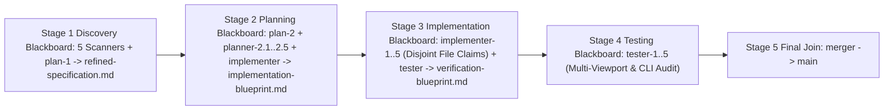

# Functional Specification 001: Ornate Chivalric Knights, Bill Atkinson Error-Diffusion Ditherpunk, and Modern Tactical HUD Interactive Election Day Portal for Tuesday, November 3, 2026

**Document Version:** 1.0 (`/craft-documentation` Functional Specification; Governed by [`LANGUAGE.md`](file:///Users/diesel/desktop/knights-ditherpunk-nov3/LANGUAGE.md))  
**Status:** Authoritative Functional & Operational Requirements Specification (`functional_specification_001.md`) — Seed Specification for [`.sandcastle/multi-stage-blackboard-pipeline-performance.ts`](file:///Users/diesel/desktop/knights-ditherpunk-nov3/.sandcastle/multi-stage-blackboard-pipeline-performance.ts).  
**DO NOT CODE YET.** This document specifies only desired `{functionality}`, architectural module boundaries, mathematical and visual contracts, operational budgets, failure-isolation rules, and objectively measurable `{correct required outputs}`. It contains zero implementation code, concrete syntax, or internal mechanical diffs.

---

## 1. Executive Summary & Desired `{functionality}`

This specification defines the complete functional requirements, domain vocabulary alignment ([`LANGUAGE.md`](file:///Users/diesel/desktop/knights-ditherpunk-nov3/LANGUAGE.md)), mathematical dithering invariants, ornate knightly iconography, modern tactical Heads-Up Display (`HUD`) overlays, operational performance budgets, and verification gates for an interactive static web application celebrating and facilitating **Voting Today on Election Day — Tuesday, November 3, 2026** (*"ORDER OF THE CIVIC AEGIS // NOVEMBER III BALLOT COMMAND"*).

The website fuses three distinct aesthetic and functional pillars into a cohesive, high-craft interactive experience:

1. **Ornate Chivalric Knights & Gothic Heraldry (`{Ornate Chivalric Knight Iconography}`):**
   - Visualizes civic duty on November 3 through ornate medieval/Renaissance gothic plate-armored knights, plumed armet and sallet helms, halberds, fluted pauldrons, pointed gothic cathedral tracery, heraldic shields, and illuminated civic scrolls.
   - Features a centerpiece interactive **Hero Knight Canvas & Heraldic Architecture** (*The Guardian of the November III Ballot*) alongside **Four Chivalric Knight Orders** representing the four stages of Election Day participation:
     1. **Order I — *Sir Vance of the Roll* (Precinct & Registration Recon):** Armored scout knight beneath a gothic arch paired with a HUD radar sweep, guiding voters through polling-place verification and registration status checks.
     2. **Order II — *Dame Astraea of the Warrant* (Ballot & Proposition Contemplation):** Knight-justiciar holding balanced scales and a broadsword, paired with the interactive Sample Ballot & Civic Proposition Contemplation Matrix.
     3. **Order III — *Sir Percival of the Queue* (Line Steadfastness & Voter Protection):** Heavy plate guardian bearing a tower shield engraved with the **In-Line Voting Right Mandate** (*"If you are in line before polls close on November 3, stay in line—your right to cast a ballot is protected by law"*).
     4. **Order IV — *Sovereign Champion of November III* (Cast Seal & Civic Crest Minting):** Radiant maximillian-armored champion presiding over the interactive **Dithered "I VOTED — NOV 3" Crest & Badge Studio**.
2. **Authentic Bill Atkinson Error-Diffusion Ditherpunk Throughout the Webpage (`{Atkinson Dithering Engine}`):**
   - Permeates the entire webpage with authentic **Bill Atkinson error-diffusion dithering** (originally engineered for early Macintosh 1-bit graphics and revered in modern *Ditherpunk* art), alongside selectable comparative Ditherpunk kernels (`Atkinson 1-Bit`, `Atkinson 2-Bit 4-Tone`, `Floyd-Steinberg Error Diffusion`, and `Ordered Bayer 8x8 Stipple`).
   - Mathematically executes true pixel-level quantization and error propagation where each pixel diffuses $\frac{1}{8}$ ($12.5\%$) of its quantization error $\Delta$ to six neighboring coordinates—$(x+1,y)$, $(x+2,y)$, $(x-1,y+1)$, $(x,y+1)$, $(x+1,y+1)$, and $(x,y+2)$—propagating $\frac{6}{8}$ ($75\%$) of total quantization error and absorbing $\frac{2}{8}$ ($25\%$) to preserve razor-sharp contrast along ornate knight armor highlights, gothic stone arches, and heraldic banners without midtone mud.
   - Provides real-time interactive dithering controls across the page (threshold slider, pixel scale `1x`/`2x`/`3x`, dither kernel selector, contrast gain, animated light-source orbit across the 3D/shaded knight reliefs, and 4 high-contrast Ditherpunk color palettes) PLUS dithers user-uploaded portraits or procedural knight scenes in real time.
3. **Modern Tactical HUD Elements (`{Modern Tactical HUD Overlay}`):**
   - Layers crisp, modern tactical Heads-Up Display (`HUD`) telemetry directly over and around the ornate dithered knight compositions:
     - Precision corner targeting brackets, crosshairs, scanline/coordinate ticks, live frame-time and kernel readouts (`KERNEL: ATKINSON_6x1/8`, `ERROR_PROP: 75.0%`, `FRAME_MS`, `VOTER_READINESS_INDEX`),
     - **Live November 3 Poll-Closing Countdown Matrix** tracking real-time remaining voting hours/minutes/seconds across all six U.S. time zones (`EST UTC-5`, `CST UTC-6`, `MST UTC-7`, `PST UTC-8`, `AKST UTC-9`, `HST UTC-10`) for **Tuesday, November 3, 2026**,
     - Interactive **5-Step Election Day Readiness Gauntlet**, **Sample Ballot & Civic Proposition Simulator**, **Voter Rights & Emergency Hotline HUD Terminal** (`866-OUR-VOTE`, `888-VE-Y-VOTA`, `888-API-VOTE`, `844-YALLA-US`), and keyboard-accessible tactical hotkeys.

---

## 2. Authoritative Glossary & Evaluation Taxonomy (`LANGUAGE.md`)

All discovery, planning, implementation, visual inspection, and verification stages MUST strictly adopt the evaluation parameters and domain vocabulary established in [`LANGUAGE.md`](file:///Users/diesel/desktop/knights-ditherpunk-nov3/LANGUAGE.md):

- **`{errors}`**: Explicit failure states or structural invariant breaches, specifically including:
  1. Leaking raw specification braces (`{Atkinson Dithering Engine}`, `{Ornate Chivalric Knight Iconography}`, `{Modern Tactical HUD Overlay}`, `{November 3 Election Day Command Center}`, `{Dithered I-Voted Crest Generator}`) into visible reader-facing DOM copy,
  2. Faking Atkinson dithering with static CSS opacity filters instead of executing genuine 6-neighbor $\frac{1}{8}$-weight Bill Atkinson error-diffusion quantization over pixel buffers,
  3. Overlapping text, illegible low-contrast typography obscured by unmasked background dither noise, or horizontal viewport overflow (`document.documentElement.scrollWidth > window.innerWidth`) at any viewport width from `320px` mobile to `2560px` desktop,
  4. Blackboard file-ownership collisions (`FILE_CLAIM_CONFLICT`) caused by two implementers or testers editing the same file without adhering to the 5-track module decomposition in Section 3,
  5. Browser console errors, uncaught runtime exceptions, broken interactive controls, external runtime network dependencies that fail offline, or a non-zero exit code from `npm run verify`.
- **`{correctness}`**: Exact mathematical, algorithmic, temporal, visual, and state-persistence fidelity:
  1. Bill Atkinson error diffusion distributes $\frac{1}{8}$ of quantization error $\Delta = I(x,y) + e(x,y) - Q(I(x,y) + e(x,y))$ to $(x+1,y)$, $(x+2,y)$, $(x-1,y+1)$, $(x,y+1)$, $(x+1,y+1)$, and $(x,y+2)$, with deterministic boundary clamping at image edges and exact 75% total error propagation,
  2. Multi-timezone November 3, 2026 poll-closing calculations accurately compute remaining time (or post-close "STAY IN LINE IF QUEUED BEFORE CLOSE" status) across `EST` (`19:00` / `20:00`), `CST` (`19:00` / `20:00`), `MST` (`19:00` / `20:00`), `PST` (`20:00`), `AKST` (`20:00`), and `HST` (`19:00`),
  3. All 5 Readiness Gauntlet steps, Sample Ballot selections, and Dithered Crest configurations persist deterministically in client storage (`LocalStorage` + in-memory snapshot fallback) with checksum/version validation and instant JSON export/reset.
- **`{functionality}`**: End-to-end interactive web experience where any voter opening [`index.html`](file:///Users/diesel/desktop/knights-ditherpunk-nov3/index.html) on November 3 can inspect live Atkinson-dithered knights and gothic heraldry framed by modern tactical HUD telemetry, switch dither kernels and palettes in real time, track live November 3 poll-closing countdowns across U.S. time zones, complete their Election Day Readiness Gauntlet and Sample Ballot plan, and mint/download a personalized Atkinson-dithered **"I VOTED — NOVEMBER 3, 2026"** knightly crest PNG.
- **`{correct required outputs}`**:
  1. [`index.html`](file:///Users/diesel/desktop/knights-ditherpunk-nov3/index.html) and [`styles/ditherpunk_hud.css`](file:///Users/diesel/desktop/knights-ditherpunk-nov3/styles/ditherpunk_hud.css) delivering the complete responsive Ornate Knights + Atkinson Ditherpunk + Modern HUD Election Day web application,
  2. [`src/atkinson_dither_engine.mjs`](file:///Users/diesel/desktop/knights-ditherpunk-nov3/src/atkinson_dither_engine.mjs) providing the high-performance Bill Atkinson error-diffusion and comparative dithering engine,
  3. [`src/knight_heraldry.mjs`](file:///Users/diesel/desktop/knights-ditherpunk-nov3/src/knight_heraldry.mjs) providing procedural shaded knight scenes, ornate gothic SVG heraldry/filigree, and the "I VOTED — NOV 3" crest renderer,
  4. [`data/election_nov3_dataset.json`](file:///Users/diesel/desktop/knights-ditherpunk-nov3/data/election_nov3_dataset.json) and [`src/civic_store.mjs`](file:///Users/diesel/desktop/knights-ditherpunk-nov3/src/civic_store.mjs) providing the November 3 civic dataset and deterministic state persistence store,
  5. [`src/hud_controller.mjs`](file:///Users/diesel/desktop/knights-ditherpunk-nov3/src/hud_controller.mjs) and [`src/verify.mjs`](file:///Users/diesel/desktop/knights-ditherpunk-nov3/src/verify.mjs) providing the tactical HUD telemetry/countdown controller and the deterministic CLI verification runner (`npm run verify` exiting `0` in `<= 250 ms`).

---

## 3. Fleet Instructions for the Sandcastle Blackboard Pipeline (`.sandcastle/multi-stage-blackboard-pipeline-performance.ts`)

To ensure zero file-lock collisions (`FILE_CLAIM_CONFLICT`) and maximum parallel velocity across the 5-stage Blackboard run, the fleet of Sandcastle Blackboard agents MUST adhere to the following stage-by-stage orchestration and exclusive file-ownership boundaries:

### 3.1 Stage 1 (`stage1-discovery`) — Scanners & `plan-1`
- `codebase-mapper`, `api-schema-mapper`, `mcp-provisioner`, `library-installer`, and `function-mapper` inspect the repository layout, verify Node.js ES module support and headless browser availability, and post their findings to the Blackboard.
- `plan-1` synthesizes all scanner findings and this seed specification into `wayfinder/{{RUN_ID}}/refined-specification.md`, preserving the exact 5-track disjoint file ownership table below.

### 3.2 Stage 2 (`stage2-planning`) — `plan-2`, `planner-2.1`..`2.5`, and `implementer`
- **Mandatory Visual Planner Activation:** Because this project is a visually ornate Ditherpunk + Knightly Heraldry + Modern Tactical HUD web application, `plan-2` **MUST immediately dispatch `planner-2.5`** via `blackboard post-request --to planner-2.5` alongside `planner-2.1`, `planner-2.2`, `planner-2.3`, and `planner-2.4`.
- `implementer` listens passively to the Stage 2 Blackboard and writes `wayfinder/{{RUN_ID}}/implementation-blueprint.md` enforcing the exact 1-to-1 disjoint file ownership mapping below:

| Specialist Track | Stage 2 Planner | Stage 3 Implementer | Stage 4 Reviewer/Tester | Exclusive Owned Files (Claim via `blackboard claim`) |
| :--- | :--- | :--- | :--- | :--- |
| **Track 1: Tactical HUD Controller, November 3 Countdown & CLI Verifier** | `planner-2.1` | `implementer-1` | `tester-1` | `src/hud_controller.mjs`, `src/verify.mjs`, `README.md` |
| **Track 2: November 3 Civic Dataset & Deterministic Snapshot Store** | `planner-2.2` | `implementer-2` | `tester-2` | `data/election_nov3_dataset.json`, `src/civic_store.mjs` |
| **Track 3: Ornate Chivalric Knight Procedural Art, Gothic SVG Heraldry & Badge Studio** | `planner-2.3` | `implementer-3` | `tester-3` | `src/knight_heraldry.mjs` |
| **Track 4: Bill Atkinson Error-Diffusion Dithering Engine & Buffer Optimization** | `planner-2.4` | `implementer-4` | `tester-4` | `src/atkinson_dither_engine.mjs` |
| **Track 5: Flagship Webpage DOM, Ornate Ditherpunk + HUD Styling & Live Visual Polish** | `planner-2.5` | `implementer-5` | `tester-5` | `index.html`, `styles/ditherpunk_hud.css` |

---

## 4. Detailed Functional & Mathematical Requirements by Subsystem

### 4.1 Subsystem 1: Bill Atkinson Error-Diffusion Dithering Engine (`src/atkinson_dither_engine.mjs`)

1. **Exact Bill Atkinson Error-Diffusion Kernel:**
   - Given a luminance or per-channel intensity buffer $I(x, y) \in [0, 255]$ of width $W$ and height $H$ and a threshold $\tau \in [1, 254]$ (default $\tau = 128$), the engine scans top-to-bottom ($y \in [0, H-1]$) and left-to-right ($x \in [0, W-1]$):
     - Effective pixel value: $v = \text{clamp}(I(x, y) + e(x, y), 0, 255)$
     - Quantized output (1-bit): $q = v \ge \tau ? 255 : 0$ (or nearest level in 2-bit 4-tone mode $\{0, 85, 170, 255\}$)
     - Quantization error: $\Delta = v - q$
     - Error unit diffused to each of the 6 Atkinson neighbors: $\delta = \Delta / 8$ (or integer bit-shift $\lfloor \Delta / 8 \rfloor$ in fast integer mode):
       - $(x + 1, y) \mathrel{+}= \delta$
       - $(x + 2, y) \mathrel{+}= \delta$
       - $(x - 1, y + 1) \mathrel{+}= \delta$
       - $(x, y + 1) \mathrel{+}= \delta$
       - $(x + 1, y + 1) \mathrel{+}= \delta$
       - $(x, y + 2) \mathrel{+}= \delta$
   - Because only $6 \times \frac{1}{8} = \frac{6}{8} = 75\%$ of $\Delta$ is propagated to neighbors and $25\%$ is absorbed locally, the engine preserves high-contrast edge definition around ornate knight armor plates and gothic filigree while producing the unmistakable organic stipple patterns of classic Atkinson dithering.
2. **Comparative Ditherpunk Kernel Modes:**
   - In addition to default `atkinson-1bit`, support live switching between:
     - `atkinson-2bit`: 4-level quantization (`0`, `85`, `170`, `255`) with $\frac{1}{8}$ 6-neighbor Atkinson error diffusion,
     - `floyd-steinberg`: 4-neighbor $\frac{1}{16}$ kernel ($7/16$ to $(x+1,y)$, $3/16$ to $(x-1,y+1)$, $5/16$ to $(x,y+1)$, $1/16$ to $(x+1,y+1)$) so users can visually compare 100% error diffusion against Atkinson's 75% error diffusion on the live knight canvas,
     - `bayer-8x8`: Ordered $8 \times 8$ threshold matrix stippling for crisp geometric cross-hatching.
3. **High-Contrast Ditherpunk Color Palettes:**
   - Map quantized luminance levels to 4 selectable high-contrast palettes:
     1. **`obsidian-bone` (Default Classic Atkinson):** Shadow `#0A0B0E`, Mid-Dark `#2B2D38`, Mid-Light `#9CA3AF`, Highlight `#F4F1EA`, Accent `#E63946`
     2. **`crimson-herald` (November 3 Civic Banner):** Shadow `#0B0708`, Mid-Dark `#4A1219`, Mid-Light `#E63946`, Highlight `#FFF8F0`, Accent `#F59E0B`
     3. **`phosphor-hud` (Tactical Night Vision):** Shadow `#050C08`, Mid-Dark `#0D3B22`, Mid-Light `#10B981`, Highlight `#D1FAE5`, Accent `#34D399`
     4. **`cobalt-aegis` (Chivalric Steel & Cobalt):** Shadow `#070B14`, Mid-Dark `#1E3A8A`, Mid-Light `#60A5FA`, Highlight `#F1F5F9`, Accent `#38BDF8`
4. **Memory & Performance Architecture:**
   - Operate using pre-allocated `Float32Array` or `Int16Array` sliding 3-row error ring buffers (`3 * W` elements instead of allocating full `W * H` error arrays on every frame) and pre-computed luminance/palette lookup tables (`Uint32Array`) so a `320x240` or `360x240` procedural knight scene dithers in `< 4.0 ms` per frame in both browser and Node.js environments.
   - Export pure, deterministic functions (`ditherGrayscaleBuffer`, `ditherRgbaBuffer`, `applyPaletteToQuantized`, `computeAtkinsonKernelVerify`, `DITHER_PALETTES`, `DITHER_KERNELS`) that work identically in Node.js (for `npm run verify`) and in the browser.

### 4.2 Subsystem 2: Ornate Chivalric Knight Procedural Art, Gothic SVG Heraldry & Crest Studio (`src/knight_heraldry.mjs`)

1. **Procedural 3D-Shaded Knight Scenes for Live Atkinson Dithering:**
   - Generate rich grayscale luminance buffers (`renderKnightSceneLuminance(sceneId, width, height, options)`) with smooth directional lighting, rim highlights, metallic armor specular gradients, gothic arch stone masonry, and billowing heraldic banners specifically designed to showcase Bill Atkinson error-diffusion dithering when passed into `atkinson_dither_engine.mjs`:
     - **`hero-guardian` (*The Guardian of the November III Ballot*):** Full gothic plate-armored knight in a fluted armet helm with visor raised/slitted, ceremonial halberd, ornate pauldrons, and heater shield embossed with `"III NOV"`, standing beneath a pointed gothic cathedral arch with a dynamic orbiting torch/moon light source (`lightAngle`) that users can scrub or animate in real time.
     - **`order-1-recon` (*Sir Vance of the Roll*):** Scout knight in bascinet helm with tactical sighting reticle and precinct scroll.
     - **`order-2-warrant` (*Dame Astraea of the Warrant*):** Justiciar knight with sword of equilibrium and civic balance scales.
     - **`order-3-queue` (*Sir Percival of the Queue*):** Heavy great-helm sentinel braced behind a fortress tower shield.
     - **`order-4-champion` (*Sovereign Champion of November III*):** Crowned maximillian knight raising the sealed November 3 civic banner.
2. **Ornate Gothic SVG Filigree & Heraldic Frames:**
   - Export crisp inline SVG generators (`getOrnateCornerFiligreeSVG`, `getGothicArchHeaderSVG`, `getKnightCrestShieldSVG`) providing intricate Victorian/medieval engraving frames, gothic rose window rosettes, sword-and-halberd dividers, and heraldic shields that pair directly with the modern HUD corner brackets.
3. **Interactive "I VOTED — NOVEMBER 3, 2026" Dithered Crest & Badge Generator:**
   - Export `renderVotedCrestLuminance(config, width, height)` and browser canvas helper `renderVotedCrestToCanvas(canvas, config, ditherEngine)` allowing any voter to enter their Callsign/Title (e.g., `"KNIGHT OF PRECINCT 04"`), choose their Chivalric Order (`I`–`IV`), select a Dither Kernel and Palette, and generate a crisp Atkinson-dithered **"I VOTED — NOV 3, 2026"** heraldic badge with a one-click **Download Dithered PNG (`nov3-i-voted-crest.png`)** button.

### 4.3 Subsystem 3: November 3 Election Day Civic Dataset & Deterministic Store (`data/election_nov3_dataset.json` & `src/civic_store.mjs`)

1. **Authoritative Election Day Dataset (`data/election_nov3_dataset.json`):**
   - Structured JSON dataset anchored to **General Election Day — Tuesday, November 3, 2026** (`"electionDate": "2026-11-03"`):
     - **`pollClosingZones`**: All 6 U.S. time zones (`EST`, `CST`, `MST`, `PST`, `AKST`, `HST`) with UTC offsets, local closing times (`19:00` and `20:00` local), representative states, and statutory in-line voting protection rule.
     - **`knightOrders`**: The 4 Chivalric Orders of the Civic Aegis with title, motto, historical armor notes, HUD tactical designation, and civic mission on November 3.
     - **`readinessGauntlet`**: 5 actionable Election Day steps voters check off (`step-1` Verify Registration & Precinct Location, `step-2` Confirm Accepted Voter ID / Provisional Ballot Rights, `step-3` Lock Sample Ballot & Proposition Choices, `step-4` Plan Transit & Poll-Closing Buffer Window, `step-5` Cast Ballot on November 3 & Mint Civic Seal).
     - **`sampleBallotContests`**: 6 nonpartisan sample ballot offices and civic propositions (Federal Representative, State Executive/Legislative, Municipal Charter Amendment, Civic Infrastructure Bond, Digital Privacy & Algorithmic Transparency Initiative, Local School & Library Levy) with plain-English pros, cons, fiscal impact notes, and interactive choice locking (`FOR` / `AGAINST` / `CANDIDATE A` / `CANDIDATE B` / `UNDECIDED`).
     - **`voterRightsAndHotlines`**: Official nonpartisan election protection resources (`866-OUR-VOTE` / `866-687-8683` English, `888-VE-Y-VOTA` / `888-839-8682` Spanish, `888-API-VOTE` / `888-274-8683` Asian languages, `844-YALLA-US` / `844-925-5287` Arabic) and the 4 cardinal Election Day legal rights (Right to stay in line if queued before poll close, Right to a replacement ballot if spoiled, Right to cast a provisional ballot, Right to assistance & accessible voting machines).
2. **Deterministic Snapshot Store (`src/civic_store.mjs`):**
   - Provides atomic read/write state management (`createCivicStore`) with monotonic revision counters, FNV-1a / CRC32 integrity checksums, automatic `localStorage` persistence in browser environments (`storageKey: "knights_ditherpunk_nov3_v1"`), and clean in-memory operation in Node.js:
     - Tracks completed Readiness Gauntlet steps (`completedSteps`), locked Sample Ballot decisions (`ballotSelections`), active Dither Studio parameters (`kernel`, `palette`, `threshold`, `pixelScale`, `animateLight`), active Timezone (`selectedZone`), and Custom Crest configuration (`callsign`, `orderId`, `sealMinted`).
     - Computes derived civic readiness metrics (`readinessPercentage`, `unlockedKnightRank`, `ballotCompletionCount`).

### 4.4 Subsystem 4: Modern Tactical HUD Controller & CLI Verification Suite (`src/hud_controller.mjs` & `src/verify.mjs`)

1. **Modern Tactical HUD Controller (`src/hud_controller.mjs`):**
   - Implements the real-time **Tactical Heads-Up Display (`HUD`) Telemetry & Countdown Engine**:
     - `computePollCountdown(nowIsoOrEpoch, zoneId, dataset)`: Deterministically computes hours, minutes, seconds, percentage of Election Day elapsed, and tactical status (`POLLS_OPEN_ACTIVE`, `FINAL_HOUR_CRITICAL`, or `POLLS_CLOSED_HOLD_THE_LINE`) relative to November 3, 2026 local poll closing times.
     - `formatHudTelemetryReadout(state, ditherStats)`: Generates crisp HUD telemetry blocks (`SYS_DATE: 2026-11-03 // ELECTION_DAY`, `KERNEL: ATKINSON_6x1/8`, `ERR_PROP: 75.0%`, `FRAME_LATENCY_MS`, `AEGIS_RANK`, `BALLOT_LOCK_RATIO`).
     - Interactive HUD reticle coordinate tracking, keyboard shortcut dispatcher (`[1-4]` switch palette, `[K]` cycle dither kernel, `[L]` toggle knight torch orbit, `[H]` toggle HUD tactical grid overlay), and live DOM binding.
2. **Deterministic CLI Verification Suite (`src/verify.mjs`):**
   - Executed via `npm run verify` (`node src/verify.mjs --verify`), performing an exhaustive, zero-network verification across all 5 subsystems in `<= 250 ms`:
     1. Verifies mathematical accuracy of the Bill Atkinson error-diffusion kernel in `src/atkinson_dither_engine.mjs` (confirming exact $\frac{1}{8}$ error distribution to $(x+1,y)$, $(x+2,y)$, $(x-1,y+1)$, $(x,y+1)$, $(x+1,y+1)$, $(x,y+2)$ and $75\%$ total propagation, plus `< 15 ms` benchmark on a `320x240` knight scene),
     2. Verifies all 5 procedural knight scenes and SVG heraldry generators in `src/knight_heraldry.mjs` produce non-empty, high-contrast buffers and valid SVG markup,
     3. Verifies schema completeness of `data/election_nov3_dataset.json` (`2026-11-03` election date, 6 U.S. time zones, 4 Knight Orders, 5 Readiness Gauntlet steps, 6 Sample Ballot items, 4 Voter Protection hotlines) and state transitions/checksums in `src/civic_store.mjs`,
     4. Verifies November 3 countdown calculations and HUD telemetry formatting in `src/hud_controller.mjs`,
     5. Verifies `index.html` and `styles/ditherpunk_hud.css` contain all required DOM section IDs, interactive canvas elements, HUD overlays, responsive layout rules, reduced-motion media queries, and zero raw specification braces (`{Atkinson Dithering Engine}`, etc.).

### 4.5 Subsystem 5: Flagship Webpage DOM & Ornate Ditherpunk + Modern HUD Stylesheet (`index.html` & `styles/ditherpunk_hud.css`)

1. **Required Semantic DOM Architecture (`index.html`):**
   - Must load self-contained local ES modules (`./src/hud_controller.mjs`, `./src/atkinson_dither_engine.mjs`, `./src/knight_heraldry.mjs`, `./src/civic_store.mjs`) and `./styles/ditherpunk_hud.css` with **zero external runtime CDN script dependencies** so the site works 100% offline and on GitHub Pages.
   - Must include the following required structural IDs and interactive components:
     - **`#hud-top-telemetry-bar`**: Sticky Modern Tactical HUD command header displaying live `NOV 03, 2026 // GENERAL ELECTION DAY` status, active dither kernel readout (`ATKINSON 1-BIT [6×1/8]`), live FPS/frame-time telemetry, voter readiness progress gauge, and quick-jump navigation links (`#section-hero-aegis`, `#section-dither-forge`, `#section-nov3-command`, `#section-knight-orders`, `#section-ballot-simulator`, `#section-voted-crest`).
     - **`#section-hero-aegis` (Ornate Knight + Modern HUD Hero Banner):**
       - Split monumental layout combining ornate gothic arch SVG filigree and chivalric typography (*"VOTE TODAY — NOVEMBER III // ORDER OF THE CIVIC AEGIS"*) with a live interactive Bill-Atkinson-dithered `<canvas id="canvas-hero-knight">` rendering *The Guardian of the November III Ballot* framed by HUD targeting brackets, live cursor reticle readout, and torch-angle lighting controls.
     - **`#section-nov3-command` (November 3 Poll-Closing Countdown & Voter Rights HUD Terminal):**
       - Multi-timezone interactive poll-closing countdown grid (`EST`, `CST`, `MST`, `PST`, `AKST`, `HST`), prominent **In-Line Voting Rights Alert Banner**, and the 4 Election Protection hotline cards (`866-OUR-VOTE`, `888-VE-Y-VOTA`, `888-API-VOTE`, `844-YALLA-US`).
     - **`#section-dither-forge` (Interactive Bill Atkinson Ditherpunk Workbench & Kernel Visualizer):**
       - Allows visitors to inspect the exact $4 \times 3$ Bill Atkinson $\frac{1}{8}$ error-diffusion matrix diagram alongside live controls for Dither Kernel (`Atkinson 1-Bit`, `Atkinson 2-Bit`, `Floyd-Steinberg`, `Ordered Bayer 8x8`), Palette (`Obsidian & Bone`, `Crimson Herald`, `Phosphor HUD`, `Cobalt Aegis`), Threshold (`1`–`254`), Pixel Scale (`1x`–`3x`), Torch Light Orbit, and optional custom image upload to dither any image in real time.
     - **`#section-knight-orders` (The Four Chivalric Orders & 5-Step Election Day Readiness Gauntlet):**
       - Interactive gallery of the 4 Knight Orders rendered on live Atkinson-dithered `<canvas>` plates (`canvas-order-1` through `canvas-order-4`) paired with the interactive 5-Step Election Day Readiness Checklist that upgrades the user's HUD Aegis Rank from *Initiate of the Roll* to *Sovereign Champion of November III*.
     - **`#section-ballot-simulator` (Tactical Sample Ballot & Civic Proposition Contemplation Matrix):**
       - Interactive sample ballot cards where voters review plain-English arguments and lock their choices (`FOR` / `AGAINST` / `CANDIDATE`), updating the HUD telemetry bar and generating a printable/exportable November 3 Ballot Summary.
     - **`#section-voted-crest` (Interactive "I VOTED — NOV 3" Atkinson-Dithered Crest & Badge Generator):**
       - Live `<canvas id="canvas-voted-crest">` studio where voters customize their callsign, knight order, and dither palette to mint and download a high-contrast Atkinson-dithered `"I VOTED — NOVEMBER 3, 2026"` heraldic seal PNG.
2. **Aesthetic & Responsive Craft (`styles/ditherpunk_hud.css`):**
   - Combines deep obsidian/parchment Ditherpunk surfaces, CSS SVG halftone/Bayer dither accent borders, ornate chivalric display headers, and crisp monospace HUD telemetry pills (`JetBrains Mono` / `SF Mono` / system monospace stacks + `Cinzel` / `Palatino` / serif chivalric display stack).
   - **Strict Anti-Obscuration & Contrast Invariant:** Every text paragraph, countdown numeral, and interactive control sits on a high-contrast card surface ($\ge 7:1$ primary text contrast, $\ge 4.5:1$ secondary telemetry contrast) so dither textures never degrade readability.
   - **Screen-Size-Agnostic Responsive Layout:** Zero horizontal page overflow (`document.documentElement.scrollWidth <= window.innerWidth`) across `320px`, `375px`, `768px`, `1024px`, `1440px`, and `1920px+` viewports, with full `@media (prefers-reduced-motion: reduce)` support.

---

## 5. Operational & Performance Budgets

| Subsystem / Metric | Mandatory Operational Budget | Observable Verification Target |
| :--- | :--- | :--- |
| **Atkinson Dither Frame Compute (`320x240` Buffer)** | `<= 8.0 ms` per frame (`>= 120 FPS` ceiling) | Verified in `npm run verify` (`atkinsonFrameMs <= 8.0`) |
| **Atkinson Error Propagation Sum** | Exact `6/8` (`0.75` / `75.0%`) diffused across 6 neighbors | Verified in `npm run verify` unit impulse test |
| **CLI End-to-End Verification (`npm run verify`)** | `<= 250 ms` total wall-clock, exit code `0` | `PASS: ALL NOVEMBER 3 KNIGHTS DITHERPUNK HUD INVARIANTS VERIFIED` |
| **External Runtime Network Requests** | `0` required external runtime scripts/APIs | 100% self-contained static bundle ready for GitHub Pages |
| **Multi-Viewport Layout Overflow (`375px` & `1440px`)** | `0 px` horizontal overflow (`scrollWidth <= innerWidth`) | Verified via headless browser inspection in Stage 3/4 |

---

## 6. Edge Cases, Failure Modes & Deterministic Recovery

1. **Image Boundary Pixels During Error Diffusion ($x = 0$, $x \ge W - 2$, $y \ge H - 2$):**
   - When diffusing error to $(x-1, y+1)$, $(x+1, y)$, $(x+2, y)$, or $(x, y+2)$ near image borders, out-of-bounds coordinates must be cleanly guarded without wrapping error across scanlines or throwing index-out-of-bounds errors.
2. **Post-Poll-Closing Timezone Transition on November 3:**
   - If the voter opens the page after local polls have closed in a given timezone on November 3, 2026, the HUD countdown must never render negative numbers (`-01:-23:-45`); instead, it must transition deterministically to the **`HOLD THE LINE // IN-QUEUE RIGHT ACTIVE`** state reminding voters already in line before poll close to remain in queue.
3. **Browser Storage Quota / Private Browsing Restrictions:**
   - If `localStorage` throws `QuotaExceededError` or `SecurityError`, `src/civic_store.mjs` must seamlessly retain state in its in-memory snapshot ledger and expose a HUD status flag (`STORAGE_MODE: MEMORY_FALLBACK`) rather than crashing the UI.
4. **Reduced Motion Accessibility (`prefers-reduced-motion: reduce`):**
   - When the user's OS requests reduced motion (or when the user clicks the HUD Pause Animation button), continuous torch-light orbit animations and radar sweeps must settle into crisp static frames while keeping manual sliders and dither controls 100% responsive.
