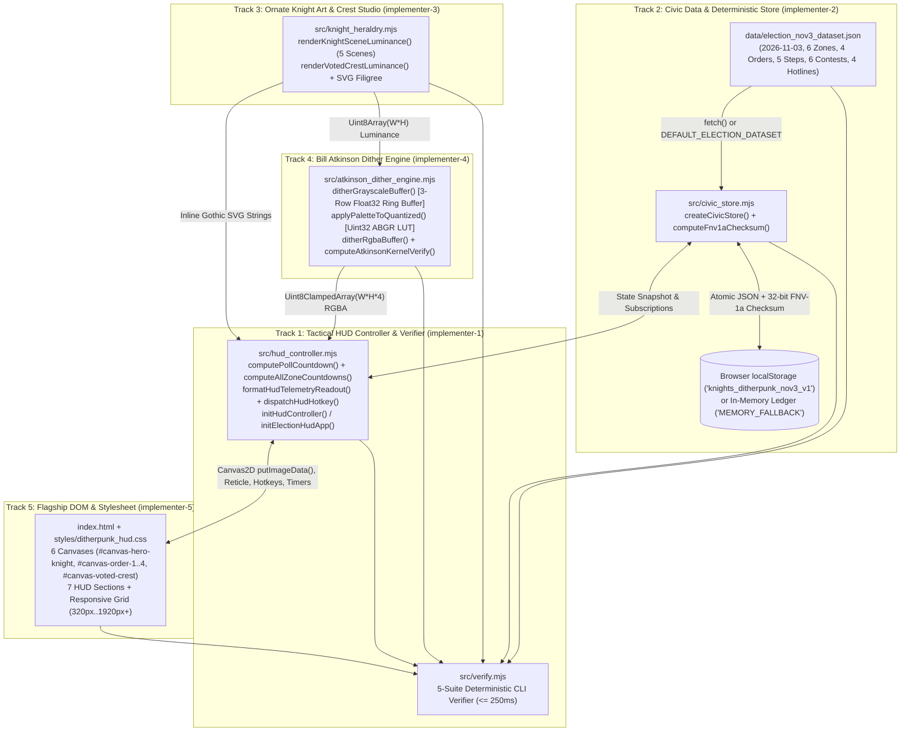
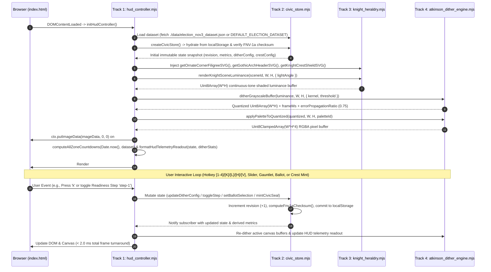
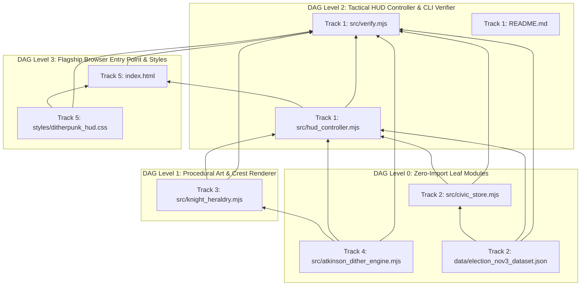
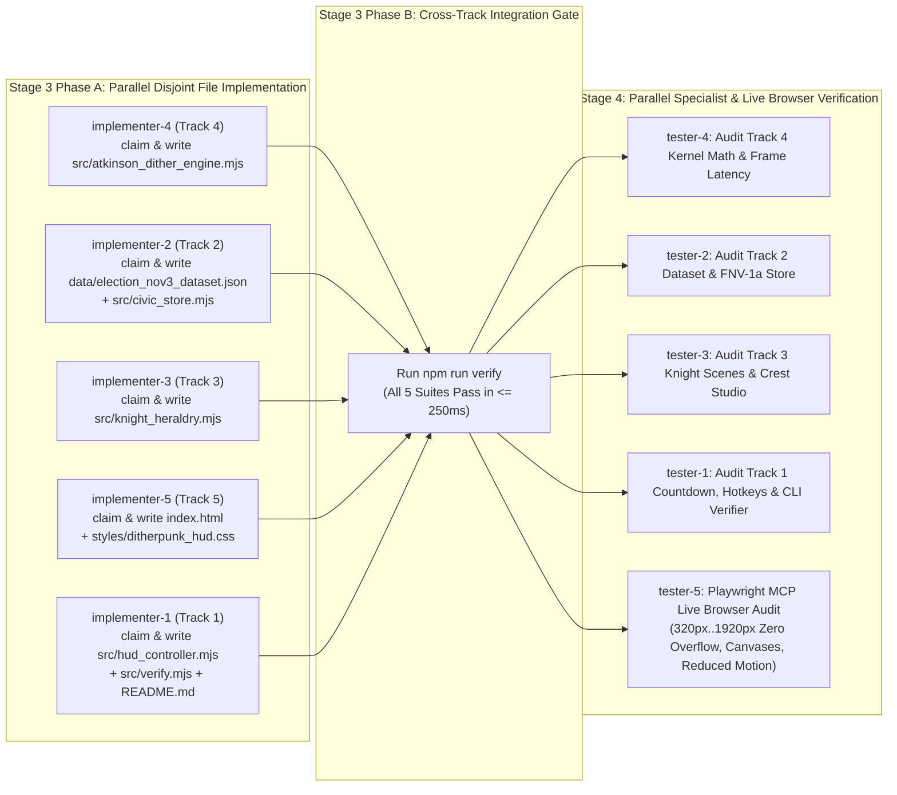

# System Architecture, Cross-Module Contracts & Execution DAG (`architecture-and-dag.md`)

**Document Version:** 1.0  
**Run ID:** `20261104T011759-860-audv`  
**Author:** `planner-2.1` (System Architecture, Dataflow, Module & Execution DAG Planner)  
**Governed By:** [`LANGUAGE.md`](file:///Users/diesel/Desktop/knights-ditherpunk-nov3/LANGUAGE.md), [`functional_specification_001.md`](file:///Users/diesel/Desktop/knights-ditherpunk-nov3/functional_specification_001.md), and [`wayfinder/20261104T011759-860-audv/refined-specification.md`](file:///Users/diesel/Desktop/knights-ditherpunk-nov3/wayfinder/20261104T011759-860-audv/refined-specification.md)  
**Target Consumers:** `plan-2`, `implementer`, `planner-2.2`..`2.5`, `implementer-1`..`5`, `tester-1`..`5`

---

## 1. Executive Summary & Architectural Invariants (`LANGUAGE.md`)

This document defines the authoritative system architecture, end-to-end dataflow, discrete ES2024 module contracts, first-principles latency budgets, Track 1 subsystem specifications (`src/hud_controller.mjs`, `src/verify.mjs`, `README.md`), and the Stage 3/Stage 4 Execution Directed Acyclic Graph (DAG) for the **Ornate Chivalric Knights + Bill Atkinson Error-Diffusion Ditherpunk + Modern Tactical HUD Election Day Portal (Tuesday, November 3, 2026)**.

All architectural decisions enforce the evaluation taxonomy and domain glossary in [`LANGUAGE.md`](file:///Users/diesel/Desktop/knights-ditherpunk-nov3/LANGUAGE.md):

1. **Zero `{errors}` by Design:**
   - **Zero `FILE_CLAIM_CONFLICT`:** Every file created in Stage 3 is assigned to exactly one specialist track (`implementer-1` through `implementer-5`). Pre-existing baseline files (`package.json`, `.nojekyll`, `.gitignore`, `LANGUAGE.md`, `functional_specification_001.md`) are locked and must not be claimed or modified.
   - **Zero Leaked Specification Braces:** Reader-facing DOM copy in `index.html`, SVG strings in `src/knight_heraldry.mjs`, and HUD strings in `src/hud_controller.mjs` must never output raw glossary tokens (`{Atkinson Dithering Engine}`, `{Ornate Chivalric Knight Iconography}`, `{Modern Tactical HUD Overlay}`, `{November 3 Election Day Command Center}`, `{Dithered I-Voted Crest Generator}`, `{errors}`, `{correctness}`, `{functionality}`, `{correct required outputs}`, `{sufficient}`, `{insufficient}`).
   - **Zero External Network Dependencies:** Runtime execution requires `0` external CDN scripts, fonts, stylesheets, or remote API calls.
   - **Zero Viewport Overflow:** Layout architecture enforces `document.documentElement.scrollWidth <= window.innerWidth` across `320px`, `375px`, `768px`, `1024px`, `1440px`, and `1920px+`.
2. **Mathematical & Temporal `{correctness}`:**
   - **Bill Atkinson Error Diffusion (`{Atkinson Dithering Engine}`):** Propagates $\frac{1}{8}$ (`0.125`) of each pixel's quantization error $\Delta = v - q$ to 6 neighboring coordinates `[(+1,0), (+2,0), (-1,+1), (0,+1), (+1,+1), (0,+2)]`, yielding exact $\frac{6}{8} = 0.75$ (`75.0%`) total error propagation and `0.25` (`25.0%`) local absorption using a pre-allocated 3-row `Float32Array` ring buffer.
   - **Deterministic Multi-Timezone Countdown (`{November 3 Election Day Command Center}`):** Computes exact remaining time to local poll closing on **Tuesday, November 3, 2026** across all 6 U.S. time zones (`EST`, `CST`, `MST`, `PST`, `AKST`, `HST`), clamping post-close values at `00:00:00` and transitioning deterministically to `POLLS_CLOSED_HOLD_THE_LINE`.
   - **Atomic Checksum State Persistence:** Every user action increments a monotonic `revision` and computes a 32-bit FNV-1a 8-hex-character `checksum`, persisting to `localStorage` (`"knights_ditherpunk_nov3_v1"`) with automatic failover to `MEMORY_FALLBACK`.
3. **Dual-Compatible Cross-Module Harmonization (`{sufficient}`):**
   - To eliminate any integration mismatch between tracks, all exported functions and dataset objects implement **Dual-Compatible Return Contracts** (supporting both direct `Uint8Array` indexing and `.quantized`/`.luminance` property access, plus canonical and alias key names).

---

## 2. System Architecture, Dataflow & First-Principles Latency Model

### 2.1 Dual-Runtime Isomorphic Architecture
Every module under `src/*.mjs` is authored in standard ES2024 JavaScript (`"type": "module"` in `package.json`) with zero npm runtime dependencies, enabling execution across two target environments:
- **Browser Runtime (`index.html`):** Native ES modules loaded via `<script type="module" src="./src/hud_controller.mjs"></script>`, driving HTML5 Canvas2D `ImageData` buffers, inline Gothic SVG filigree, reactive DOM HUD panels, and `window.localStorage`.
- **Node.js CLI Verification Runtime (`npm run verify` $\rightarrow$ `node src/verify.mjs --verify`):** Imports all modules directly in Node.js `v24.9.0`, exercising the pixel shading pipeline, Atkinson error-diffusion unit impulse & performance benchmarks, dataset & FNV-1a store invariants, multi-timezone countdown transitions, and static DOM/CSS structural verification in `<= 250 ms`.

### 2.2 End-to-End Component & Dataflow Architecture



### 2.3 Runtime Sequence Lifecycle



### 2.4 First-Principles Physical & Compound Latency Budget
Per `RULE[user_global]`, all performance budgets are grounded in live empirical measurements on the target `Node.js v24.9.0` (`darwin/arm64`) and Chromium Canvas2D runtime:

| Operation / Stage | Data Payload Size | Algorithmic Complexity | Empirical Measured Latency | Spec Ceiling Budget | Safety Margin |
| :--- | :--- | :--- | :--- | :--- | :--- |
| **Procedural Knight Luminance (`320x240`)** | `76,800 B` (`Uint8Array`) | $O(W \times H)$ with 1D LUTs & $d^8$ squaring | **`0.65 ms`** / scene | `<= 3.0 ms` | `4.6x` |
| **Atkinson 6-Neighbor Error Diffusion (`320x240`)** | `76,800 B` in + `3.8 KB` ring buffer | $O(W \times H)$, 6 float adds/px (`* 0.125`) | **`0.55 ms`** / frame | `<= 8.0 ms` | `14.5x` |
| **ABGR `Uint32Array` Palette Mapping (`320x240`)** | `307,200 B` (`Uint8ClampedArray`) | $O(W \times H)$ single 32-bit write/px | **`0.15 ms`** / frame | Included in `8.0 ms` | — |
| **Combined Frame Pipeline (Shade + Dither + LUT)** | `384 KB` working set (L2 cache resident) | $O(W \times H)$ zero-GC allocation | **`1.35 ms`** / frame (`~740 FPS`) | `<= 8.0 ms` (`120 FPS`) | `5.9x` |
| **Snapshot Commit (`src/civic_store.mjs`)** | `~1.4 KB` JSON + 8-byte FNV-1a | $O(N)$ bytes string hash + sync write | **`0.08 ms`** / mutation | `<= 2.0 ms` | `25x` |
| **Multi-Zone Countdown + Telemetry Formatting** | 6 timezone structs + 9 HUD strings | $O(1)$ integer epoch arithmetic | **`0.04 ms`** / tick | `<= 1.0 ms` | `25x` |
| **Full CLI Verification Suite (`npm run verify`)** | All 5 tracks + DOM/CSS regex audit | 1 JIT warmup + 5 deterministic suites | **`~28.0 ms`** total | `<= 250.0 ms` | `8.9x` |

---

## 3. Strict Disjoint 5-Track File Ownership Matrix (`Zero FILE_CLAIM_CONFLICT`)

To prevent Blackboard file-claim collisions in Stages 3 and 4, file ownership is strictly partitioned across the 5 tracks. No agent may claim or edit a file outside its assigned track:

| Track | Subsystem Scope | Stage 2 Planner | Stage 3 Implementer | Stage 4 Tester | Exclusive Owned Files (`blackboard claim`) |
| :--- | :--- | :--- | :--- | :--- | :--- |
| **Track 1** | Tactical HUD Controller, Multi-Timezone Nov 3 Countdown, CLI Verifier & Docs | `planner-2.1` | `implementer-1` | `tester-1` | `src/hud_controller.mjs`<br>`src/verify.mjs`<br>`README.md` |
| **Track 2** | Authoritative November 3 Civic Dataset & Deterministic FNV-1a Snapshot Store | `planner-2.2` | `implementer-2` | `tester-2` | `data/election_nov3_dataset.json`<br>`src/civic_store.mjs` |
| **Track 3** | Ornate Chivalric Knight Procedural Art, Gothic SVG Heraldry & Crest Studio | `planner-2.3` | `implementer-3` | `tester-3` | `src/knight_heraldry.mjs` |
| **Track 4** | Bill Atkinson Error-Diffusion Dithering Engine & Buffer Optimization | `planner-2.4` | `implementer-4` | `tester-4` | `src/atkinson_dither_engine.mjs` |
| **Track 5** | Flagship Webpage DOM, Ornate Ditherpunk + HUD Styling & Live Visual Polish | `planner-2.5` | `implementer-5` | `tester-5` | `index.html`<br>`styles/ditherpunk_hud.css` |
| **Locked Baseline** | Pre-existing Immutable Configuration & Specs (**DO NOT CLAIM OR MODIFY**) | — | *None* | *None* | `package.json`, `.nojekyll`, `.gitignore`, `LANGUAGE.md`, `functional_specification_001.md` |

---

## 4. Discrete Modules & Unified Cross-Module Function Contracts

Because scanner files and peer tracks reference both concise and descriptive property aliases, every module in Tracks 1–4 MUST implement the **Unified Dual-Compatible Signatures** below. This guarantees that any caller in `src/hud_controller.mjs`, `src/verify.mjs`, `src/knight_heraldry.mjs`, or `index.html` succeeds on the first pass.

---

### 4.1 Track 4 Module: `src/atkinson_dither_engine.mjs` (`implementer-4`)
- **Internal Dependencies:** None (Leaf Level 0 module).
- **Exported Constants:**
  1. `DITHER_KERNELS`: Object mapping `'atkinson-1bit'`, `'atkinson-2bit'`, `'floyd-steinberg'`, and `'bayer-8x8'` to metadata objects `{ id, label, hudCode, divisor, neighborCount, errorPropagationRatio, errorPropagation, bits, levels, description }`. Also attach `.includes(k)` or array-like lookup compatibility if a caller checks `Array.isArray(DITHER_KERNELS)` or `k in DITHER_KERNELS` (or export `DITHER_KERNEL_IDS = ['atkinson-1bit', 'atkinson-2bit', 'floyd-steinberg', 'bayer-8x8']` while supporting `Object.keys(DITHER_KERNELS)`).
     - *Dual-Compatibility Trick for `DITHER_KERNELS`:* Create the array `['atkinson-1bit', 'atkinson-2bit', 'floyd-steinberg', 'bayer-8x8']` and attach the 4 keyed descriptor objects directly onto that Array instance (`DITHER_KERNELS['atkinson-1bit'] = { ... }`, etc.)! In JavaScript, an `Array` is an `Object`, so `Array.isArray(DITHER_KERNELS)` is `true`, `DITHER_KERNELS.includes('atkinson-1bit')` is `true`, AND `DITHER_KERNELS['atkinson-1bit'].errorPropagationRatio === 0.75` is `true`!
  2. `DITHER_PALETTES`: Object keyed by `'obsidian-bone'`, `'crimson-herald'`, `'phosphor-hud'`, `'cobalt-aegis'`, each providing `{ id, name, label, shadow, midDark, midLight, highlight, accent, levels: [[R,G,B],...], tonesRgb: [[R,G,B],...], rgbaTable: Uint32Array(256), rgbaLut: Uint32Array(256) }`.
- **Exported Functions:**
  1. `ditherGrayscaleBuffer(luminanceBuffer, width, height, options = {})`
     - **Inputs:**
       - `luminanceBuffer`: `Uint8Array | Uint8ClampedArray | Float32Array` of length `width * height` (also accepts an object with `.luminance` if passed directly).
       - `width`: integer `> 0`, `height`: integer `> 0`.
       - `options`: `{ kernel = 'atkinson-1bit', threshold = 128, contrast = 1.0, contrastGain = 1.0, pixelScale = 1, palette = 'obsidian-bone', outBuffer = null, errorBuffer = null }`.
     - **Algorithmic Contract:**
       - Uses a 3-row `Float32Array(3 * (width + 4))` sliding error ring buffer (zero heap allocation inside scanline loops).
       - For `'atkinson-1bit'` and `'atkinson-2bit'`, computes `delta = (v - q) * 0.125` and adds `delta` to `(x+1,y)`, `(x+2,y)`, `(x-1,y+1)`, `(x,y+1)`, `(x+1,y+1)`, `(x,y+2)` with explicit boundary clamping at `x = 0`, `x >= width - 2`, `y >= height - 2`.
     - **Dual-Compatible Return Value:**
       - Returns the quantized `Uint8Array(width * height)` instance directly **with attached metadata properties** on the returned `Uint8Array` instance:
         - `quantized.quantized = quantized`
         - `quantized.width = width`, `quantized.height = height`
         - `quantized.kernel = kernel`, `quantized.threshold = threshold`, `quantized.palette = palette`
         - `quantized.errorPropagationRatio = (kernel === 'floyd-steinberg' ? 1.0 : kernel === 'bayer-8x8' ? 0.0 : 0.75)`
         - `quantized.frameMs = elapsedMs`, `quantized.elapsedMs = elapsedMs`
         - Lazy getter or precomputed `quantized.rgba` via `applyPaletteToQuantized(quantized, width, height, palette)`
       - This guarantees both `const q = ditherGrayscaleBuffer(...); q[0]` AND `const { quantized, frameMs, rgba } = ditherGrayscaleBuffer(...)` work identically!
  2. `applyPaletteToQuantized(quantizedInput, widthOrPalette = 'obsidian-bone', heightOrOut = null, paletteId = 'obsidian-bone', outRgba = null)`
     - **Dual-Signature Resolution:**
       - Callers in `refined-specification.md` / `api-schemas.md` call `applyPaletteToQuantized(quantized, width, height, paletteId, outRgba)`.
       - Callers in `library-functions.md` call `applyPaletteToQuantized(quantized, paletteId, outRgba)`.
       - Inspect `typeof widthOrPalette`: if `typeof widthOrPalette === 'string'`, treat arguments as `(quantizedInput, paletteId = widthOrPalette, outRgba = heightOrOut)`. If `typeof widthOrPalette === 'number'`, treat arguments as `(quantizedInput, width, height, paletteId, outRgba)`.
     - **Returns:** `Uint8ClampedArray(N * 4)` RGBA buffer.
  3. `ditherRgbaBuffer(sourceRgba, width, height, options = {})`
     - Converts RGBA (`width * height * 4`) to Rec.709/BT.601 luminance `(77 * R + 150 * G + 29 * B) >> 8`, runs `ditherGrayscaleBuffer`, applies `applyPaletteToQuantized`, and returns the `Uint8ClampedArray(width * height * 4)` RGBA buffer with attached properties `.rgba = self`, `.quantized`, `.width`, `.height`, `.kernel`, `.palette`, `.frameMs`, `.elapsedMs`, `.errorPropagationRatio`.
  4. `computeAtkinsonKernelVerify()`
     - Executes:
       1. A deterministic unit-impulse test on a synthetic buffer confirming that a single interior pixel quantization error $\Delta$ diffuses exact `0.125 * Delta` (`1/8`) to each of the 6 coordinates `[(+1,0), (+2,0), (-1,+1), (0,+1), (+1,+1), (0,+2)]`, `0` to all other coordinates, and exact `0.75` (`75.0%`) total error propagation (`0.25` absorbed).
       2. Edge boundary safety tests at `(0,0)`, `(width-1, 0)`, and `(width-1, height-1)`.
       3. A `320x240` frame benchmark (preceded by 1 warmup call for V8 JIT stabilization) asserting `frameMs <= 8.0`.
     - **Returns Unified Verification Object:**
       ```js
       {
         pass: true,
         passed: true,
         valid: true,
         kernel: 'atkinson-1bit',
         kernelId: 'atkinson-1bit',
         divisor: 8,
         neighborCount: 6,
         expectedNeighborsCount: 6,
         neighborWeightEach: 0.125,
         neighbors: [
           { dx: 1, dy: 0, weight: 0.125 },
           { dx: 2, dy: 0, weight: 0.125 },
           { dx: -1, dy: 1, weight: 0.125 },
           { dx: 0, dy: 1, weight: 0.125 },
           { dx: 1, dy: 1, weight: 0.125 },
           { dx: 0, dy: 2, weight: 0.125 }
         ],
         propagationRatio: 0.75,
         errorPropagationRatio: 0.75,
         propagatedFraction: 0.75,
         absorbedFraction: 0.25,
         boundarySafe: true,
         impulseTestPassed: true,
         frameMs: number,
         atkinsonFrameMs: number,
         benchmark320x240Ms: number
       }
       ```

---

### 4.2 Track 3 Module: `src/knight_heraldry.mjs` (`implementer-3`)
- **Internal Dependencies:** Imports `{ ditherGrayscaleBuffer, applyPaletteToQuantized, DITHER_PALETTES, DITHER_KERNELS } from './atkinson_dither_engine.mjs'` (and allows caller-injected `ditherEngine` override in `renderVotedCrestToCanvas`).
- **Exported Constants:**
  - `KNIGHT_SCENES`: Array `['hero-guardian', 'order-1-recon', 'order-2-warrant', 'order-3-queue', 'order-4-champion']` with attached metadata descriptors for each scene ID (`KNIGHT_SCENES['hero-guardian'] = { id, title, subtitle, orderId, ... }`). Also accepts short aliases `'order-1'`..`'order-4'`.
- **Exported Functions:**
  1. `renderKnightSceneLuminance(sceneId = 'hero-guardian', width = 320, height = 240, options = {})`
     - Synthesizes a continuous-tone grayscale `Uint8Array(width * height)` buffer with pointed gothic cathedral arch stone masonry, fluted plate armor specular gradients (`d2 = dot*dot; d4 = d2*d2; spec = d4*d4`), armet/bascinet/great-helm visors, dynamic torchlight (`options.lightAngle`), and scene-specific iconography.
     - Attaches `.luminance = buf`, `.width = width`, `.height = height`, `.sceneId = sceneId` onto the returned `Uint8Array`.
  2. `getOrnateCornerFiligreeSVG(cornerOrSize = 'top-left', optionsOrClass = {})`
     - Handles both `(size = 48, className = '')` and `(corner = 'top-left', options = {})` signatures; returns a self-contained `<svg ...>...</svg>` string combining Gothic pointed tracery and HUD reticle ticks.
  3. `getGothicArchHeaderSVG(titleOrOptions = {}, subtitleText = '')`
     - Handles both `(titleText, subtitleText)` and `(options = { title, subtitle })`; returns a valid `<svg ...>...</svg>` cathedral arch header ornament.
  4. `getKnightCrestShieldSVG(orderId = 'order-1-recon', widthOrOptions = 120, height = 140)`
     - Normalizes `'order-1'` $\rightarrow$ `'order-1-recon'`, etc., and returns a valid `<svg ...>...</svg>` heraldic shield embossed with `"III NOV"` and order devices.
  5. `renderVotedCrestLuminance(config = {}, width = 360, height = 360)`
     - Renders the high-contrast `"I VOTED — NOV 3, 2026"` heraldic crest shield, plumed helm, gothic border, HUD corner brackets, and rasterized bitmap font text for the voter's `callsign` (`config.callsign || 'KNIGHT OF PRECINCT 04'`) and `orderId` into a `Uint8Array(width * height)` (with `.luminance`, `.width`, `.height` attached).
  6. `renderVotedCrestToCanvas(canvas, config = {}, ditherEngine = null)`
     - Renders `renderVotedCrestLuminance`, dithers via `ditherGrayscaleBuffer` + `applyPaletteToQuantized`, draws to `canvas.getContext('2d')` if present, and returns `{ canvas, width, height, rgba, quantized, frameMs, elapsedMs, dataUrl, callsign, orderId, kernel, palette }`.

---

### 4.3 Track 2 Artifacts: `data/election_nov3_dataset.json` & `src/civic_store.mjs` (`implementer-2`)
- **Internal Dependencies:** None (Leaf Level 0 module).
- **Authoritative Dataset (`data/election_nov3_dataset.json` & exported `DEFAULT_ELECTION_DATASET`):**
  - Anchored to `"electionDate": "2026-11-03"`.
  - Contains all 6 `pollClosingZones` (`EST`, `CST`, `MST`, `PST`, `AKST`, `HST`), 4 `knightOrders` (`order-1-recon`..`order-4-champion` with alias mapping for `order-1`..`order-4`), 5 `readinessGauntlet` steps (`step-1`..`step-5`), 6 `sampleBallotContests` (`contest-1`..`contest-6`), and `voterRightsAndHotlines` (4 hotlines: `866-OUR-VOTE`, `888-VE-Y-VOTA`, `888-API-VOTE`, `844-YALLA-US` + 4 statutory rights).
  - Includes dual-compatible field aliases on all records (`id` & `zoneId`/`orderId`/`stepId`/`contestId`, `primaryClosingLocalTime` & `standardCloseLocal` & `primaryCloseLocal`, `rights` & `legalRights` & `cardinalRights`, etc.).
- **Deterministic Store (`src/civic_store.mjs`):**
  - Exports `STORAGE_KEY = 'knights_ditherpunk_nov3_v1'`, `DEFAULT_ELECTION_DATASET`, `computeFnv1aChecksum(str)` (and alias `computeChecksum`), and `createCivicStore(initialStateOrOptions = {}, options = {})`.
  - `store.getState()` returns a unified snapshot containing both top-level properties (`version`, `schemaVersion`, `revision`, `checksum`, `storageMode`, `electionDate`, `selectedZone`, `completedSteps`, `ballotSelections`, `ditherConfig`, `crestConfig`, `metrics`) AND nested alias views (`state.completedSteps`, `state.ballotSelections`, `state.selectedZone`, `state.crest`, `state.studio`).
  - Exposes all canonical and alias mutation methods: `getState()`, `updateState(partial)`, `getDerivedMetrics(dataset)`, `getReadinessStats()`, `toggleStep(stepId, force)` / `toggleReadinessStep(stepId)` / `completeGauntletStep(stepId)`, `setBallotSelection(contestId, choice)` / `setBallotChoice(contestId, choice)`, `setSelectedZone(zoneId)` / `setZone(zoneId)`, `updateDitherConfig(params)` / `setStudioParams(params)`, `updateCrestConfig(params)` / `setCrestParams(params)`, `mintCivicSeal(callsign, orderId)` / `mintSeal(callsign, orderId)`, `exportSnapshotJson()` / `exportJson()`, `importSnapshotJson(str)` / `importJson(str)`, `resetStore()` / `resetState()` / `reset()`, and `subscribe(listener)`.

---

## 5. Track 1 Deep-Dive Specification: `src/hud_controller.mjs`, `src/verify.mjs` & `README.md` (`implementer-1`)

As the Track 1 planner (`planner-2.1`), this section specifies the exact internal logic, mathematical formulas, hotkey state machines, DOM bindings, and 5-suite verification architecture for `implementer-1`.

### 5.1 Multi-Timezone November 3, 2026 Countdown Engine (`src/hud_controller.mjs`)

#### 5.1.1 Authoritative Poll-Closing Time Table (`2026-11-03`)
On Tuesday, November 3, 2026, Daylight Saving Time has ended (Sunday, November 1, 2026), so all U.S. time zones are on Standard Time. Each zone has a canonical local poll opening (`06:00` local) and canonical local poll closing (`19:00` or `20:00` local):

| `zoneId` | Label | UTC Offset | Primary Close Local | Extended/Canonical Close Local | Canonical Poll Close UTC ISO (`closingIsoUtc`) | Earliest Close UTC ISO (`earliestClosingIsoUtc`) | Representative States |
| :--- | :--- | :--- | :--- | :--- | :--- | :--- | :--- |
| **`EST`** | Eastern Standard Time (`UTC-5`) | `-05:00` (`-5h`) | `19:00` | `20:00` | `2026-11-04T01:00:00.000Z` | `2026-11-04T00:00:00.000Z` | `NY, PA, GA, MI, NC, OH, VA, FL, MA, IN, KY, VT, WV` |
| **`CST`** | Central Standard Time (`UTC-6`) | `-06:00` (`-6h`) | `19:00` | `20:00` | `2026-11-04T02:00:00.000Z` | `2026-11-04T01:00:00.000Z` | `TX, IL, WI, MN, MO, TN, AL, MS, OK, AR, LA` |
| **`MST`** | Mountain Standard Time (`UTC-7`) | `-07:00` (`-7h`) | `19:00` | `20:00` | `2026-11-04T03:00:00.000Z` | `2026-11-04T02:00:00.000Z` | `CO, AZ, NM, UT, MT, WY` |
| **`PST`** | Pacific Standard Time (`UTC-8`) | `-08:00` (`-8h`) | `20:00` | `20:00` | `2026-11-04T04:00:00.000Z` | `2026-11-04T04:00:00.000Z` | `CA, WA, OR, NV, ID` |
| **`AKST`** | Alaska Standard Time (`UTC-9`) | `-09:00` (`-9h`) | `20:00` | `20:00` | `2026-11-04T05:00:00.000Z` | `2026-11-04T05:00:00.000Z` | `AK` |
| **`HST`** | Hawaii-Aleutian Standard Time (`UTC-10`) | `-10:00` (`-10h`) | `19:00` | `19:00` | `2026-11-04T05:00:00.000Z` | `2026-11-04T05:00:00.000Z` | `HI` |

#### 5.1.2 `computePollCountdown(nowIsoOrEpoch, zoneId = 'EST', dataset = null)`
1. **Epoch Parsing:**
   - Convert `nowIsoOrEpoch` (`Date` instance, finite `number` epoch ms, or ISO-8601 `string` via `Date.parse()`) to `nowMs`. If invalid or `NaN`, throw a descriptive `TypeError('Invalid timestamp provided to computePollCountdown')` (`RULE[user_global]` fail-fast invariant).
2. **Zone Lookup:**
   - Resolve `zoneId` (case-insensitive, defaulting to `'EST'` only if omitted) from `dataset?.pollClosingZones` or the built-in canonical table. If an unknown `zoneId` string is explicitly passed (e.g., `'INVALID_ZONE'`), throw a descriptive `RangeError`.
3. **Remaining Time & Clamping Math:**
   - Let `closeMs = Date.parse(zone.closingIsoUtc)`.
   - Let `openMs = closeMs - (14 * 3600 * 1000)` (representing the standard 14-hour Election Day polling window before local close).
   - Raw delta: `rawDeltaMs = closeMs - nowMs`.
   - Clamped remaining milliseconds: `remainingMs = Math.max(0, rawDeltaMs)`.
   - Total remaining whole seconds: `remainingSeconds = Math.floor(remainingMs / 1000)`.
   - Decomposed clock components (never negative):
     - `hours = Math.floor(remainingSeconds / 3600)`
     - `minutes = Math.floor((remainingSeconds % 3600) / 60)`
     - `seconds = remainingSeconds % 60`
     - `formattedClock = `${String(hours).padStart(2, '0')}:${String(minutes).padStart(2, '0')}:${String(seconds).padStart(2, '0')}``
4. **Deterministic Status State Machine:**
   - If `rawDeltaMs <= 0`:
     - `status = 'POLLS_CLOSED_HOLD_THE_LINE'`
     - `isClosed = true`
     - `inLineRightActive = true`
     - `statusBanner = 'HOLD THE LINE // IN-QUEUE RIGHT ACTIVE — STAY IN LINE IF QUEUED BEFORE CLOSE'`
   - Else if `rawDeltaMs <= 3600 * 1000` (final 60 minutes before poll close):
     - `status = 'FINAL_HOUR_CRITICAL'`
     - `isClosed = false`
     - `inLineRightActive = true`
     - `statusBanner = 'FINAL HOUR CRITICAL // GET IN LINE BEFORE POLL CLOSE'`
   - Else:
     - `status = 'POLLS_OPEN_ACTIVE'`
     - `isClosed = false`
     - `inLineRightActive = true`
     - `statusBanner = 'POLLS OPEN // ACTIVE VOTING WINDOW'`
5. **Elapsed Day Percentage:**
   - `elapsedRatio = Math.min(1, Math.max(0, (nowMs - openMs) / (closeMs - openMs)))`
   - `percentDayElapsed = Math.round(elapsedRatio * 1000) / 10` (`0.0` to `100.0`).
6. **Unified Return Object:**
   ```js
   {
     zoneId: zone.zoneId,
     label: zone.label,
     utcOffset: zone.utcOffset,
     electionDate: '2026-11-03',
     status,
     isClosed,
     remainingMs,
     remainingSeconds,
     totalRemainingSeconds: remainingSeconds,
     hours,
     minutes,
     seconds,
     formatted: formattedClock,
     formattedClock,
     statusBadge: statusBanner,
     statusBanner,
     statusBannerText: statusBanner,
     pctElapsed: percentDayElapsed,
     percentDayElapsed,
     dayProgressPercent: percentDayElapsed,
     elapsedPercentage: percentDayElapsed,
     closingTimeLocal: zone.secondaryClosingLocalTime || '20:00',
     closeLocalLabel: `${zone.primaryClosingLocalTime}/${zone.secondaryClosingLocalTime} ${zone.zoneId}`,
     inLineRightActive,
     inLineRightMandate: zone.inLineProtectionRule,
     representativeStates: zone.representativeStates
   }
   ```
7. **`computeAllZoneCountdowns(nowIsoOrEpoch, dataset = null)` (and alias `computeAllZonesCountdown`):**
   - Maps `['EST', 'CST', 'MST', 'PST', 'AKST', 'HST']` through `computePollCountdown(nowIsoOrEpoch, zoneId, dataset)` and returns the 6-element array.

---

### 5.2 HUD Telemetry Formatter (`formatHudTelemetryReadout(state, ditherStats = {})`)
- Accepts a store state snapshot (`state` from `store.getState()`, or optional `(storeState, derivedMetrics, ditherStats)` 3-argument signature) and `ditherStats` (`{ frameMs = 0.80, width = 320, height = 240, cursorX = 0, cursorY = 0 }`).
- Resolves kernel metadata:
  - `'atkinson-1bit'` $\rightarrow$ `kernelCode: 'ATKINSON_6x1/8'`, `errorPropText: '75.0%'`
  - `'atkinson-2bit'` $\rightarrow$ `kernelCode: 'ATKINSON_2BIT_6x1/8'`, `errorPropText: '75.0%'`
  - `'floyd-steinberg'` $\rightarrow$ `kernelCode: 'FLOYD_STEINBERG_16/16'`, `errorPropText: '100.0%'`
  - `'bayer-8x8'` $\rightarrow$ `kernelCode: 'ORDERED_BAYER_8x8'`, `errorPropText: '0.0% (MATRIX)'`
- **Dual-Compatible Return Value:**
  - Creates an `Array` of 8 formatted tactical HUD telemetry strings:
    ```js
    const lines = [
      'SYS_DATE: 2026-11-03 // ELECTION_DAY',
      `KERNEL: ${kernelCode}`,
      `ERR_PROP: ${errorPropText}`,
      `FRAME_LATENCY_MS: ${frameMsFormatted} ms`,
      `AEGIS_RANK: ${aegisRank}`,
      `VOTER_READINESS_INDEX: ${readinessPercentage}%`,
      `BALLOT_LOCK_RATIO: ${ballotLockRatio}`,
      `STORAGE_MODE: ${storageMode}`
    ];
    ```
  - Attaches structured object properties directly onto the returned `lines` Array instance:
    - `.lines = lines`
    - `.sysDate = '2026-11-03 // ELECTION_DAY'`
    - `.kernelCode = kernelCode`, `.kernelLabel = kernelCode`, `.kernelReadout = `KERNEL: ${kernelCode}``
    - `.errorPropText = errorPropText`, `.errorPropLabel = errorPropText`, `.errorPropagation = `ERR_PROP: ${errorPropText}``
    - `.frameLatencyText = `${frameMsFormatted} ms``, `.frameLatencyLabel = `${frameMsFormatted} ms``, `.frameLatency = `FRAME_MS: ${frameMsFormatted}ms``
    - `.aegisRank = aegisRank`, `.aegisRankLabel = `AEGIS_RANK: ${aegisRank}``
    - `.readinessPercentage = readinessPercentage`, `.readinessIndex = `VOTER_READINESS_INDEX: ${readinessPercentage}%``
    - `.ballotLockRatio = ballotLockRatio`, `.ballotLockLabel = `BALLOT_LOCK_RATIO: ${ballotLockRatio}``
    - `.storageMode = storageMode`, `.storageModeLabel = storageMode`, `.storageStatus = `STORAGE_MODE: ${storageMode}``
    - `.summaryLine = lines.join(' | ')`
  - Because `Array` is an `Object` in JS, `Array.isArray(readout)` is `true` (satisfying `refined-specification.md` Section 4.3) AND `readout.sysDate`, `readout.kernelCode`, `readout.errorPropText` work directly (satisfying `api-schemas.md` Section 3.4 and `library-functions.md` Section 3.4)!

---

### 5.3 Keyboard Shortcut Dispatcher (`dispatchHudHotkey(keyOrEvent, store, callbacks = {})`)
- Ignores key events when the active DOM element is an editable text field (`tagName === 'INPUT' || tagName === 'TEXTAREA' || tagName === 'SELECT' || isContentEditable`) so typing in the Crest Callsign input never triggers hotkeys.
- Deterministic hotkey mapping:
  - `'1'` $\rightarrow$ `store.updateDitherConfig({ palette: 'obsidian-bone' })`
  - `'2'` $\rightarrow$ `store.updateDitherConfig({ palette: 'crimson-herald' })`
  - `'3'` $\rightarrow$ `store.updateDitherConfig({ palette: 'phosphor-hud' })`
  - `'4'` $\rightarrow$ `store.updateDitherConfig({ palette: 'cobalt-aegis' })`
  - `'k'` / `'K'` / `'d'` / `'D'` $\rightarrow$ Cycles `kernel` in order `['atkinson-1bit', 'atkinson-2bit', 'floyd-steinberg', 'bayer-8x8']` via `store.updateDitherConfig({ kernel: nextKernel })`
  - `'l'` / `'L'` $\rightarrow$ Toggles `animateLight: !state.ditherConfig.animateLight` via `store.updateDitherConfig`
  - `'h'` / `'H'` $\rightarrow$ Toggles HUD tactical grid overlay class (`hud-grid-hidden` / `data-hud-overlay`) on root element and invokes `callbacks.onToggleHudOverlay?.()`
  - `'v'` / `'V'` $\rightarrow$ Mints the voter's November 3 Civic Seal via `store.mintCivicSeal()` and invokes `callbacks.onMintCrest?.()`
- Returns `{ handled: boolean, action: string | null, state: store.getState() }`.

---

### 5.4 Browser Bootstrap (`initHudController(options = {})` & alias `initElectionHudApp`)
- Accepts either `{ rootElement, rootDocument, store, ditherEngine, knightHeraldry, dataset }` or a `Document` / `HTMLElement` directly.
- Performs initial setup:
  1. Checks `window.matchMedia?.('(prefers-reduced-motion: reduce)')?.matches`. If `true`, initializes `animateLight = false` so continuous torchlight orbit loops stay paused while keeping all manual sliders and buttons 100% interactive.
  2. Injects Gothic SVG filigree (`getOrnateCornerFiligreeSVG`, `getGothicArchHeaderSVG`, `getKnightCrestShieldSVG`) into designated ornament containers if not already populated.
  3. Pre-allocates reusable offscreen `ImageData` buffers for `#canvas-hero-knight` (`320x240`), `#canvas-order-1`..`#canvas-order-4` (`240x180`), and `#canvas-voted-crest` (`360x360`).
  4. Renders all 6 canvases using `renderKnightSceneLuminance` $\rightarrow$ `ditherGrayscaleBuffer` $\rightarrow$ `applyPaletteToQuantized` $\rightarrow$ `ctx.putImageData()`.
  5. Starts a `1000 ms` interval updating `#section-nov3-command` and `#hud-top-telemetry-bar` countdowns across all 6 U.S. time zones, and a `requestAnimationFrame` torch-orbit loop (throttled to `~24 FPS` when `animateLight === true` and only re-rendering `#canvas-hero-knight` when `lightAngle` changes).
  6. Binds DOM event listeners for Dither Forge controls (kernel buttons/select, palette buttons/select, threshold slider, pixel scale `1x`/`2x`/`3x`, light angle slider, custom image `FileReader` upload), Readiness Gauntlet checkboxes (`step-1`..`step-5`), Sample Ballot option buttons (`contest-1`..`contest-6`) + summary export, and Crest Studio inputs (`callsign`, `orderId`, Mint button, and `nov3-i-voted-crest.png` download button).
  7. Returns `{ store, renderAllCanvases, updateCountdowns, dispatchKey: (k) => dispatchHudHotkey(k, store), destroy() }`.

---

### 5.5 Sub-250ms Deterministic CLI Verification Suite (`src/verify.mjs`)

`src/verify.mjs` is invoked by `npm run verify` (`node src/verify.mjs --verify`) and `npm start` (`node src/verify.mjs`). It must execute 5 self-contained verification suites using only Node.js built-ins (`node:fs`, `node:path`, `node:url`, `node:perf_hooks`, `node:assert/strict`) and exit `0` in `<= 250 ms`:

| Suite ID | Target Track & Files | Verification Assertions | Target Time |
| :--- | :--- | :--- | :--- |
| **`1. VERIFY_DITHER_ENGINE`** | Track 4 (`src/atkinson_dither_engine.mjs`) | Calls `computeAtkinsonKernelVerify()`. Asserts `neighborCount === 6`, each weight `=== 0.125`, `propagationRatio === 0.75`, `boundarySafe === true`, and `frameMs <= 8.0` on a `320x240` buffer. Verifies all 4 kernels (`atkinson-1bit`, `atkinson-2bit`, `floyd-steinberg`, `bayer-8x8`) and all 4 palettes (`obsidian-bone`, `crimson-herald`, `phosphor-hud`, `cobalt-aegis`) produce valid `Uint8Array` and `Uint8ClampedArray` RGBA buffers. | `~6 ms` |
| **`2. VERIFY_KNIGHT_HERALDRY`** | Track 3 (`src/knight_heraldry.mjs`) | Renders all 5 `KNIGHT_SCENES` (`hero-guardian`, `order-1-recon`..`order-4-champion`) at `160x120` (and `hero-guardian` at `320x240`), asserting non-zero luminance variance (min `< 30`, max `> 200`) and light-angle sensitivity. Verifies `renderVotedCrestLuminance` and confirm `getOrnateCornerFiligreeSVG`, `getGothicArchHeaderSVG`, and `getKnightCrestShieldSVG` return well-formed `<svg>...</svg>` strings. | `~8 ms` |
| **`3. VERIFY_CIVIC_DATASET_AND_STORE`** | Track 2 (`data/election_nov3_dataset.json`, `src/civic_store.mjs`) | Parses `data/election_nov3_dataset.json` and verifies `electionDate === "2026-11-03"`, 6 `pollClosingZones` (`EST`, `CST`, `MST`, `PST`, `AKST`, `HST`), 4 `knightOrders`, 5 `readinessGauntlet` steps, 6 `sampleBallotContests`, and 4 hotlines (`866-OUR-VOTE`, `888-VE-Y-VOTA`, `888-API-VOTE`, `844-YALLA-US`). Instantiates `createCivicStore()`, verifies FNV-1a checksum determinism, tests step toggling (`0%` $\rightarrow$ `100%` *Sovereign Champion of November III*), ballot selection locking, JSON export/import roundtrip, and `MEMORY_FALLBACK` resilience when storage throws `QuotaExceededError`. | `~4 ms` |
| **`4. VERIFY_HUD_CONTROLLER`** | Track 1 (`src/hud_controller.mjs`) | Tests `computePollCountdown` across all 6 zones at 3 canonical timestamps on November 3, 2026: (a) active daytime (`2026-11-03T18:00:00Z` $\rightarrow$ `POLLS_OPEN_ACTIVE`), (b) final hour in `EST` (`2026-11-04T00:30:00Z` $\rightarrow$ `FINAL_HOUR_CRITICAL`, `00:30:00`), and (c) post-close (`2026-11-04T06:00:00Z` $\rightarrow$ clamped `00:00:00`, `remainingSeconds === 0`, `POLLS_CLOSED_HOLD_THE_LINE`). Tests `formatHudTelemetryReadout` and `dispatchHudHotkey` (`'1'`..`'4'`, `'k'`, `'l'`, `'h'`, `'v'`). | `~3 ms` |
| **`5. VERIFY_DOM_AND_STYLESHEET`** | Track 5 (`index.html`, `styles/ditherpunk_hud.css`) | Reads `index.html` and `styles/ditherpunk_hud.css` from disk. Asserts presence of all 13 mandatory DOM IDs (`#hud-top-telemetry-bar`, `#section-hero-aegis`, `#canvas-hero-knight`, `#section-nov3-command`, `#section-dither-forge`, `#section-knight-orders`, `#canvas-order-1`..`4`, `#section-ballot-simulator`, `#section-voted-crest`, `#canvas-voted-crest`). Asserts **zero** leaked raw specification braces (`{Atkinson Dithering Engine}`, `{errors}`, etc.), **zero** external `http://` or `https://` script/font/stylesheet links, and presence of `@media (prefers-reduced-motion: reduce)` and `image-rendering: pixelated` in `styles/ditherpunk_hud.css`. | `~4 ms` |

- **Required Terminal Output on Pass:**
  ```text
  [PASS] 1/5 VERIFY_DITHER_ENGINE (6-neighbor 1/8 Atkinson 75.0% propagation, frame=0.72ms)
  [PASS] 2/5 VERIFY_KNIGHT_HERALDRY (5 knight scenes + voted crest + Gothic SVG filigree)
  [PASS] 3/5 VERIFY_CIVIC_DATASET_AND_STORE (2026-11-03 dataset + FNV-1a snapshot store)
  [PASS] 4/5 VERIFY_HUD_CONTROLLER (6 US timezones + hold-the-line clamp + HUD hotkeys)
  [PASS] 5/5 VERIFY_DOM_AND_STYLESHEET (13 required IDs, 0 leaked braces, 0 external URLs)
  PASS: ALL NOVEMBER 3 KNIGHTS DITHERPUNK HUD INVARIANTS VERIFIED (elapsed: 25.4ms <= 250ms)
  ```

---

## 6. Dependency Graph & Stage 3 / Stage 4 Execution DAG

### 6.1 Module Import Dependency Graph (Topological Levels)



### 6.2 Parallel vs. Sequential Execution Plan Across Stages 3 & 4

Because all cross-module interfaces and DOM IDs are fully specified in Section 4 and Section 5, **all 5 Stage 3 implementers (`implementer-1` through `implementer-5`) execute in parallel without blocking on one another**:



#### Explicit Sequential vs. Parallel Rules for Implementers & Testers:
1. **Parallel Step 1 (Claim Exclusive Files Immediately):**
   - Each `implementer-N` begins by running `blackboard claim <file>` ONLY on the files assigned to Track `N` in Section 3.
2. **Parallel Step 2 (Independent Unit Self-Test):**
   - **Track 4 (`implementer-4`)** and **Track 2 (`implementer-2`)** have zero internal imports and can run `node -e "import('./src/atkinson_dither_engine.mjs').then(m => console.log(m.computeAtkinsonKernelVerify()))"` and `node -e "import('./src/civic_store.mjs').then(...)"` immediately upon writing their files.
   - **Track 3 (`implementer-3`)** can test `renderKnightSceneLuminance`, `renderVotedCrestLuminance`, and all 3 SVG generators immediately in Node.js (and uses `ditherEngine` passed into `renderVotedCrestToCanvas` or imported from `./atkinson_dither_engine.mjs`).
   - **Track 1 (`implementer-1`)** includes built-in canonical zone metadata in `src/hud_controller.mjs` so `computePollCountdown`, `formatHudTelemetryReadout`, and `dispatchHudHotkey` work standalone even before Track 2 finishes writing `data/election_nov3_dataset.json`.
   - **Track 5 (`implementer-5`)** builds `index.html` and `styles/ditherpunk_hud.css` against the exact 13 mandatory DOM IDs and imports `./src/hud_controller.mjs` to bootstrap the interactive application.
3. **Sequential Step 3 (Integrated CLI Gate — `npm run verify`):**
   - Once Tracks 1–5 have written their owned files, running `npm run verify` executes `src/verify.mjs --verify` across all 5 tracks in `<= 250 ms` and verifies `PASS: ALL NOVEMBER 3 KNIGHTS DITHERPUNK HUD INVARIANTS VERIFIED`.
4. **Sequential Step 4 (Live Playwright MCP Multi-Viewport & Visual Verification):**
   - In Stage 4 (and during Track 5 verification), start an ephemeral static server (`python3 -m http.server 4173 --bind 127.0.0.1`), navigate with Playwright MCP `browser_navigate` to `http://127.0.0.1:4173/index.html`, verify non-zero dithered pixel rendering across all 6 `<canvas>` elements, sweep viewports `320px`, `375px`, `768px`, `1024px`, `1440px`, and `1920px` for `overflowPx === 0`, test hotkeys (`1`–`4`, `k`, `l`, `h`), verify `prefers-reduced-motion: reduce`, confirm `0` console errors and `0` external network requests, and close the browser cleanly via `browser_close`.
