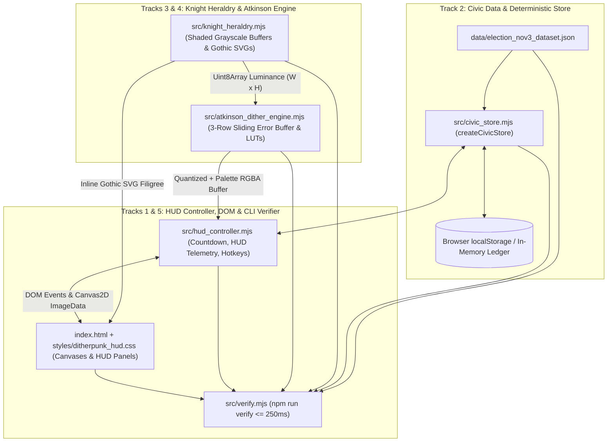

# Codebase & Runtime Dataflow Map (`wayfinder/20261104T011759-860-audv/codebase-map.md`)

**Run ID:** `20261104T011759-860-audv`  
**Scanner:** `codebase-mapper`  
**Governed By:** [`LANGUAGE.md`](file:///Users/diesel/Desktop/knights-ditherpunk-nov3/.sandcastle/worktrees/agent-codebase-mapper-20261104T011759-860-audv/LANGUAGE.md) & [`functional_specification_001.md`](file:///Users/diesel/Desktop/knights-ditherpunk-nov3/.sandcastle/worktrees/agent-codebase-mapper-20261104T011759-860-audv/functional_specification_001.md)

---

## 1. Current Project Shape & Entry Points

### 1.1 Existing Repository Layout (Pre-Implementation Baseline)
The repository is a greenfield, zero-external-runtime-dependency ES Module project initialized with specification, domain vocabulary, and Sandcastle pipeline configuration files:

```text
.
├── .gitignore                        # Ignores node_modules, logs, scratch, and ephemeral worktrees
├── .nojekyll                         # Present (0 bytes) for static GitHub Pages serving without Jekyll filtering
├── LANGUAGE.md                       # Authoritative glossary & evaluation taxonomy ({errors}, {correctness}, etc.)
├── functional_specification_001.md   # Seed functional & mathematical specification
├── package.json                      # ESM package configuration ("type": "module") and npm scripts
└── .sandcastle/                      # Sandcastle multi-stage blackboard orchestration & agent prompts
```

### 1.2 Runtime & Entry Point Configuration ([`package.json`](file:///Users/diesel/Desktop/knights-ditherpunk-nov3/.sandcastle/worktrees/agent-codebase-mapper-20261104T011759-860-audv/package.json))
- **Node.js / NPM Environment:** Node.js `v24.9.0`, npm `11.6.0`, `"type": "module"` enabled in [`package.json`](file:///Users/diesel/Desktop/knights-ditherpunk-nov3/.sandcastle/worktrees/agent-codebase-mapper-20261104T011759-860-audv/package.json).
- **Configured CLI Entry Points:**
  - `npm start` $\rightarrow$ `node src/verify.mjs`
  - `npm run verify` $\rightarrow$ `node src/verify.mjs --verify` (Must exit `0` within `<= 250 ms` wall-clock time).
- **Configured Browser Entry Point:**
  - `index.html` (Static HTML5 document served at repository root for local HTTP servers and GitHub Pages, loading `./styles/ditherpunk_hud.css` and local ES modules `./src/*.mjs` with zero external runtime network requests).
- **Locked Existing Files (DO NOT MODIFY in Stage 3):**
  - `package.json`, `.nojekyll`, `.gitignore`, `LANGUAGE.md`, and `functional_specification_001.md` are already properly configured and committed. No Stage 3 implementer needs to claim or edit `package.json`.

### 1.3 Target Directory & Module Structure (To Be Created in Stage 3)
```text
.
├── README.md                         # [Track 1: implementer-1] Architecture, controls, verification & deployment docs
├── index.html                        # [Track 5: implementer-5] Flagship interactive DOM & ES module bootstrap
├── styles/
│   └── ditherpunk_hud.css            # [Track 5: implementer-5] Ditherpunk + Gothic Heraldry + Modern Tactical HUD styles
├── data/
│   └── election_nov3_dataset.json    # [Track 2: implementer-2] Authoritative Nov 3, 2026 civic & timezone dataset
└── src/
    ├── atkinson_dither_engine.mjs    # [Track 4: implementer-4] Bill Atkinson 6x(1/8) & comparative dither engine
    ├── knight_heraldry.mjs           # [Track 3: implementer-3] Procedural 3D-shaded knight scenes, SVG filigree & Crest Studio
    ├── civic_store.mjs               # [Track 2: implementer-2] Deterministic FNV-1a snapshot store (LocalStorage + RAM fallback)
    ├── hud_controller.mjs            # [Track 1: implementer-1] Multi-zone Nov 3 countdown, HUD telemetry & DOM controller
    └── verify.mjs                    # [Track 1: implementer-1] Deterministic CLI verification runner (<= 250 ms)
```

---

## 2. End-to-End Runtime Dataflow & Storage Architecture



### 2.1 Dual-Environment Execution Flow
Every `.mjs` module in `src/` is designed for isomorphic execution in both **Browser ES Modules** and **Node.js `v24.9.0` CLI**:

1. **Static Authoritative Dataset (`data/election_nov3_dataset.json`):**
   - Anchored to `"electionDate": "2026-11-03"`.
   - Loaded via `fs.readFileSync` in Node.js (`src/verify.mjs`) and via `fetch('./data/election_nov3_dataset.json')` (with embedded/exported fallback or direct JSON import/fetch) in the browser.
   - Contains the 6 U.S. poll-closing time zones (`EST`, `CST`, `MST`, `PST`, `AKST`, `HST`), 4 Chivalric Knight Orders (`order-1-recon` through `order-4-champion`), 5 Readiness Gauntlet steps (`step-1` through `step-5`), 6 nonpartisan Sample Ballot contests/propositions, and 4 Voter Protection hotlines (`866-OUR-VOTE`, `888-VE-Y-VOTA`, `888-API-VOTE`, `844-YALLA-US`) plus legal rights mandates.

2. **Deterministic State Persistence (`src/civic_store.mjs`):**
   - Manages mutable user state (`completedSteps`, `ballotSelections`, `kernel`, `palette`, `threshold`, `pixelScale`, `animateLight`, `lightAngle`, `selectedZone`, `callsign`, `orderId`, `sealMinted`).
   - Wraps every state transition in an atomic snapshot commit that increments a monotonic `revision` counter and computes a deterministic 32-bit FNV-1a checksum (`checksum`).
   - Persists to `window.localStorage` under key `"knights_ditherpunk_nov3_v1"` when available; if running in Node.js or if `localStorage` throws `QuotaExceededError`/`SecurityError`, falls back cleanly to an in-memory Map ledger and reports `storageMode: "MEMORY_FALLBACK"` (`"LOCAL_STORAGE"` when active in browser).

3. **Procedural Knight Shading $\rightarrow$ Bill Atkinson Error Diffusion (`src/knight_heraldry.mjs` $\rightarrow$ `src/atkinson_dither_engine.mjs`):**
   - `src/knight_heraldry.mjs` synthesizes continuous-tone grayscale luminance buffers (`Uint8Array` of length $W \times H$) for 5 knight scenes (`hero-guardian`, `order-1-recon`, `order-2-warrant`, `order-3-queue`, `order-4-champion`) and the custom `"I VOTED — NOV 3"` crest (`renderVotedCrestLuminance`), incorporating dynamic directional lighting (`lightAngle`), gothic arch masonry, fluted armor specular highlights, and embossed heraldry.
   - `src/atkinson_dither_engine.mjs` accepts the grayscale `Uint8Array` (or custom uploaded `Uint8ClampedArray` RGBA buffer), applies contrast gain and threshold $\tau \in [1, 254]$, and executes Bill Atkinson error diffusion using a pre-allocated 3-row sliding error buffer (`Float32Array` or `Int16Array` of length $3 \times W$) that diffuses $\delta = \Delta / 8$ to $(x+1,y)$, $(x+2,y)$, $(x-1,y+1)$, $(x,y+1)$, $(x+1,y+1)$, and $(x,y+2)$ (propagating $6/8 = 75\%$ of error and absorbing $25\%$).
   - Maps quantized values (`0`/`255` in 1-bit mode or `{0, 85, 170, 255}` in 2-bit 4-tone mode) through pre-computed `Uint32Array` palette lookup tables (`obsidian-bone`, `crimson-herald`, `phosphor-hud`, `cobalt-aegis`) into an output `Uint8ClampedArray` RGBA buffer (`W * H * 4`) ready for `ctx.putImageData()`.

4. **Tactical HUD Telemetry & Poll-Closing Countdown (`src/hud_controller.mjs` $\leftrightarrow$ `index.html`):**
   - Computes real-time countdowns for all 6 U.S. time zones against November 3, 2026 local closing hours (`19:00` / `20:00`), clamping post-close timestamps at `00:00:00` and transitioning status to `POLLS_CLOSED_HOLD_THE_LINE` (`"HOLD THE LINE // IN-QUEUE RIGHT ACTIVE"`).
   - Formats HUD telemetry readouts (`KERNEL: ATKINSON_6x1/8`, `ERR_PROP: 75.0%`, `FRAME_LATENCY_MS`, `AEGIS_RANK`, `BALLOT_LOCK_RATIO`) and binds interactive controls, canvases, reticle coordinates, and keyboard shortcuts (`[1-4]`, `[K]`/`[D]`, `[L]`, `[H]`, `[V]`) to `index.html`.

---

## 3. Existing Modules & Functions to Reuse vs. Greenfield Contracts

Because `src/`, `styles/`, `data/`, and `index.html` do not yet exist in the workspace, there are no legacy source code functions to refactor. Instead, all 5 Stage 3 implementers must implement and consume the following **exact cross-module export contracts** so that `index.html`, `src/hud_controller.mjs`, and `src/verify.mjs` integrate on the first pass without import errors.

### 3.1 Track 4 Contract: `src/atkinson_dither_engine.mjs` (`implementer-4`)
- **Exported Constants:**
  - `DITHER_KERNELS`: Object/Map defining metadata and weights for `'atkinson-1bit'`, `'atkinson-2bit'`, `'floyd-steinberg'`, and `'bayer-8x8'`.
  - `DITHER_PALETTES`: Object mapping `'obsidian-bone'`, `'crimson-herald'`, `'phosphor-hud'`, and `'cobalt-aegis'` to `{ id, name, shadow, midDark, midLight, highlight, accent, rgbaLut }`.
- **Exported Functions:**
  - `ditherGrayscaleBuffer(luminanceBuffer, width, height, options = {})`
    - **Inputs:** `luminanceBuffer` (`Uint8Array | Uint8ClampedArray` of size `width * height`), `width` (`number`), `height` (`number`), `options` (`{ kernel = 'atkinson-1bit', threshold = 128, contrast = 1.0, pixelScale = 1, palette = 'obsidian-bone' }`).
    - **Returns:** `{ quantized: Uint8Array, rgba: Uint8ClampedArray, width: number, height: number, kernel: string, palette: string, elapsedMs: number, errorPropagationRatio: number }`.
  - `ditherRgbaBuffer(rgbaInput, width, height, options = {})`
    - Converts RGBA input to Rec.709/BT.601 luminance (`(77*R + 150*G + 29*B) >> 8`) and delegates to `ditherGrayscaleBuffer`.
  - `applyPaletteToQuantized(quantizedBuffer, width, height, paletteId = 'obsidian-bone', outRgba = null)`
    - Maps quantized levels (`0..255`) into an RGBA `Uint8ClampedArray` (`width * height * 4`) using the selected palette.
  - `computeAtkinsonKernelVerify()`
    - Runs a deterministic unit-impulse verification on a synthetic buffer confirming exact $\frac{1}{8}$ ($0.125$) error distribution to each of the 6 Atkinson neighbors `[(+1,0), (+2,0), (-1,+1), (0,+1), (+1,+1), (0,+2)]`, exact `0.75` (`75.0%`) total error propagation, `0.25` (`25.0%`) local absorption, and safe edge clamping at $x=0$, $x \ge W-2$, $y \ge H-2$.

### 3.2 Track 3 Contract: `src/knight_heraldry.mjs` (`implementer-3`)
- **Exported Constants:**
  - `KNIGHT_SCENES`: Metadata list for `'hero-guardian'`, `'order-1-recon'`, `'order-2-warrant'`, `'order-3-queue'`, and `'order-4-champion'`.
- **Exported Functions:**
  - `renderKnightSceneLuminance(sceneId, width = 320, height = 240, options = {})`
    - **Inputs:** `sceneId` (`string`), `width` (`number`), `height` (`number`), `options` (`{ lightAngle = 0.65, contrast = 1.0, frameTick = 0 }`).
    - **Returns:** `Uint8Array` of length `width * height` containing rich 3D-shaded grayscale luminance values (`0..255`) with gothic arch framing, fluted armor specular gradients, and heraldic iconography.
  - `getOrnateCornerFiligreeSVG(options = {})` $\rightarrow$ Returns valid inline `<svg>...</svg>` string for corner brackets/filigree.
  - `getGothicArchHeaderSVG(options = {})` $\rightarrow$ Returns valid inline `<svg>...</svg>` string for pointed gothic cathedral arch headers.
  - `getKnightCrestShieldSVG(orderId = 'order-1-recon', options = {})` $\rightarrow$ Returns valid inline `<svg>...</svg>` string for each Chivalric Order's heraldic shield.
  - `renderVotedCrestLuminance(config = {}, width = 360, height = 360)`
    - **Inputs:** `config` (`{ callsign = 'KNIGHT OF THE POLLS', orderId = 'order-4-champion', dateText = 'NOVEMBER 3, 2026', precinct = 'CIVIC AEGIS' }`), `width`, `height`.
    - **Returns:** `Uint8Array` (`width * height`) grayscale buffer depicting the ornate `"I VOTED — NOV 3, 2026"` heraldic seal with baked bitmap typography, shield, and helm crest.
  - `renderVotedCrestToCanvas(canvas, config = {}, ditherEngine)`
    - Renders `renderVotedCrestLuminance` through `ditherEngine.ditherGrayscaleBuffer` onto a browser `<canvas>` and returns `{ dataUrl, width, height, elapsedMs }`.

### 3.3 Track 2 Contract: `data/election_nov3_dataset.json` & `src/civic_store.mjs` (`implementer-2`)
- **Dataset Schema (`data/election_nov3_dataset.json`):**
  - Top-level keys: `electionDate` (`"2026-11-03"`), `portalTitle`, `pollClosingZones` (6 zones: `EST`, `CST`, `MST`, `PST`, `AKST`, `HST`), `knightOrders` (4 orders), `readinessGauntlet` (5 steps), `sampleBallotContests` (6 contests/propositions), `voterRightsAndHotlines` (4 hotlines + 4 statutory rights).
- **Store Factory (`src/civic_store.mjs`):**
  - `createCivicStore(options = {})`
    - **Inputs:** `{ storageKey = 'knights_ditherpunk_nov3_v1', storage = globalThis.localStorage, dataset = null }`.
    - **Methods on returned store instance:**
      - `getState()` $\rightarrow$ Returns immutable snapshot `{ revision, checksum, storageMode, selectedZone, completedSteps, ballotSelections, ditherConfig: { kernel, palette, threshold, pixelScale, contrast, animateLight, lightAngle }, crestConfig: { callsign, orderId, sealMinted, mintedAt } }`.
      - `getDerivedMetrics(dataset)` $\rightarrow$ Returns `{ readinessPercentage, completedStepCount, totalSteps, unlockedKnightRank, unlockedOrderId, ballotCompletionCount, totalContests, ballotLockRatio }`.
      - `toggleReadinessStep(stepId)` $\rightarrow$ Toggles step completion, updates revision & FNV-1a checksum, persists to storage, and returns updated snapshot.
      - `setBallotSelection(contestId, choiceId)` $\rightarrow$ Locks sample ballot choice (`FOR`, `AGAINST`, `CANDIDATE_A`, `CANDIDATE_B`, `UNDECIDED`) and returns updated snapshot.
      - `updateDitherConfig(partialConfig)` $\rightarrow$ Updates dither studio parameters (`kernel`, `palette`, `threshold`, `pixelScale`, `animateLight`, `lightAngle`).
      - `updateCrestConfig(partialCrest)` $\rightarrow$ Updates voter crest callsign/order/minted status.
      - `setSelectedZone(zoneId)` $\rightarrow$ Switches active U.S. timezone (`EST`, `CST`, `MST`, `PST`, `AKST`, `HST`).
      - `exportSnapshotJson()` / `importSnapshotJson(jsonString)` / `resetStore()` $\rightarrow$ Deterministic JSON export, checksum-validated import, and factory reset.
  - `computeFnv1aChecksum(payloadString)` $\rightarrow$ Exported pure helper returning deterministic 8-char hex checksum string.

### 3.4 Track 1 Contract: `src/hud_controller.mjs` & `src/verify.mjs` (`implementer-1`)
- **`src/hud_controller.mjs` Exports:**
  - `computePollCountdown(nowInput, zoneId = 'EST', dataset = null)`
    - **Inputs:** `nowInput` (ISO string, epoch ms, or `Date`), `zoneId` (`'EST' | 'CST' | 'MST' | 'PST' | 'AKST' | 'HST'`), `dataset`.
    - **Returns:** `{ zoneId, hours, minutes, seconds, totalRemainingSeconds, formattedClock: 'HH:MM:SS', dayProgressPercent, status: 'POLLS_OPEN_ACTIVE' | 'FINAL_HOUR_CRITICAL' | 'POLLS_CLOSED_HOLD_THE_LINE', statusBannerText, inLineRightMandate }`.
  - ` computeAllZoneCountdowns(nowInput, dataset = null)` $\rightarrow$ Array of countdown objects for all 6 U.S. time zones.
  - `formatHudTelemetryReadout(storeState, derivedMetrics, ditherStats = {})`
    - **Returns:** Structured telemetry object & formatted HUD strings (`sysDate: '2026-11-03 // ELECTION_DAY'`, `kernelLabel`, `errorPropLabel: '75.0%'`, `frameLatencyLabel`, `aegisRankLabel`, `ballotLockLabel`, `storageModeLabel`).
  - `dispatchHudHotkey(key, store, controllerCallbacks = {})`
    - Pure/testable hotkey handler supporting `'1'`–`'4'` (palettes), `'k'`/`'K'`/`'d'`/`'D'` (cycle dither kernel), `'l'`/`'L'` (toggle torch light orbit), `'h'`/`'H'` (toggle HUD grid overlay), `'v'`/`'V'` (mint civic seal).
  - `initElectionHudApp(rootDocument = globalThis.document)`
    - Browser bootstrap function invoked by `index.html` that wires the store, dataset, canvases, countdown timers, HUD overlays, and event listeners.
- **`src/verify.mjs` CLI Runner:**
  - Executed via `node src/verify.mjs --verify` (`npm run verify`), verifying all 5 tracks and exiting with code `0` in `<= 250 ms` while printing `PASS: ALL NOVEMBER 3 KNIGHTS DITHERPUNK HUD INVARIANTS VERIFIED`.

---

## 4. Required Code Additions, Disjoint Blackboard Ownership & Callers

To prevent `FILE_CLAIM_CONFLICT` during Stage 3 and Stage 4, every file to be created is assigned to a single specialist track:

| Track | Stage 2 Planner | Stage 3 Implementer | Stage 4 Tester | Exclusive Owned Files (`blackboard claim`) | Upstream Callers / Downstream Consumers |
| :--- | :--- | :--- | :--- | :--- | :--- |
| **Track 1** | `planner-2.1` | `implementer-1` | `tester-1` | `src/hud_controller.mjs`, `src/verify.mjs`, `README.md` | **Imports:** `src/atkinson_dither_engine.mjs`, `src/knight_heraldry.mjs`, `src/civic_store.mjs`, `data/election_nov3_dataset.json`<br>**Called by:** `index.html` (`initElectionHudApp`), `package.json` (`npm run verify` $\rightarrow$ `src/verify.mjs`) |
| **Track 2** | `planner-2.2` | `implementer-2` | `tester-2` | `data/election_nov3_dataset.json`, `src/civic_store.mjs` | **Imports:** Pure standard JS/JSON<br>**Called by:** `src/hud_controller.mjs`, `src/verify.mjs`, `index.html` |
| **Track 3** | `planner-2.3` | `implementer-3` | `tester-3` | `src/knight_heraldry.mjs` | **Imports:** Uses `ditherEngine` passed in or imported from `src/atkinson_dither_engine.mjs`<br>**Called by:** `src/hud_controller.mjs`, `src/verify.mjs`, `index.html` |
| **Track 4** | `planner-2.4` | `implementer-4` | `tester-4` | `src/atkinson_dither_engine.mjs` | **Imports:** Pure standard JS (`Uint8Array`, `Uint8ClampedArray`, `Float32Array`, `Int16Array`, `Uint32Array`)<br>**Called by:** `src/knight_heraldry.mjs`, `src/hud_controller.mjs`, `src/verify.mjs`, `index.html` |
| **Track 5** | `planner-2.5` | `implementer-5` | `tester-5` | `index.html`, `styles/ditherpunk_hud.css` | **Imports:** `./styles/ditherpunk_hud.css`, `./src/hud_controller.mjs`, `./src/atkinson_dither_engine.mjs`, `./src/knight_heraldry.mjs`, `./src/civic_store.mjs`<br>**Inspected by:** `src/verify.mjs`, headless browser multi-viewport audits |

### 4.1 Critical DOM & Stylesheet Invariants Required in Track 5 (`index.html` & `styles/ditherpunk_hud.css`)
- **Required DOM Section & Element IDs in `index.html`:**
  - `#hud-top-telemetry-bar` (Sticky HUD command bar)
  - `#section-hero-aegis` containing `<canvas id="canvas-hero-knight">`
  - `#section-nov3-command` (6-timezone countdown matrix, In-Line Voting Rights banner, 4 Election Protection hotline cards)
  - `#section-dither-forge` (Interactive Bill Atkinson $4 \times 3$ kernel matrix diagram, kernel/palette/threshold/scale/light controls, custom image upload)
  - `#section-knight-orders` containing `<canvas id="canvas-order-1">`, `<canvas id="canvas-order-2">`, `<canvas id="canvas-order-3">`, `<canvas id="canvas-order-4">`, and the 5-step Readiness Gauntlet checklist
  - `#section-ballot-simulator` (6 nonpartisan sample ballot & proposition cards + summary export)
  - `#section-voted-crest` containing `<canvas id="canvas-voted-crest">` and one-click PNG download (`nov3-i-voted-crest.png`)
- **Strict Anti-Leak Invariant:**
  - `index.html` and rendered DOM text must contain **zero** raw specification braces (`{Atkinson Dithering Engine}`, `{Ornate Chivalric Knight Iconography}`, `{Modern Tactical HUD Overlay}`, `{November 3 Election Day Command Center}`, `{Dithered I-Voted Crest Generator}`, `{errors}`, `{correctness}`, `{functionality}`, `{correct required outputs}`, `{sufficient}`, `{insufficient}`).
