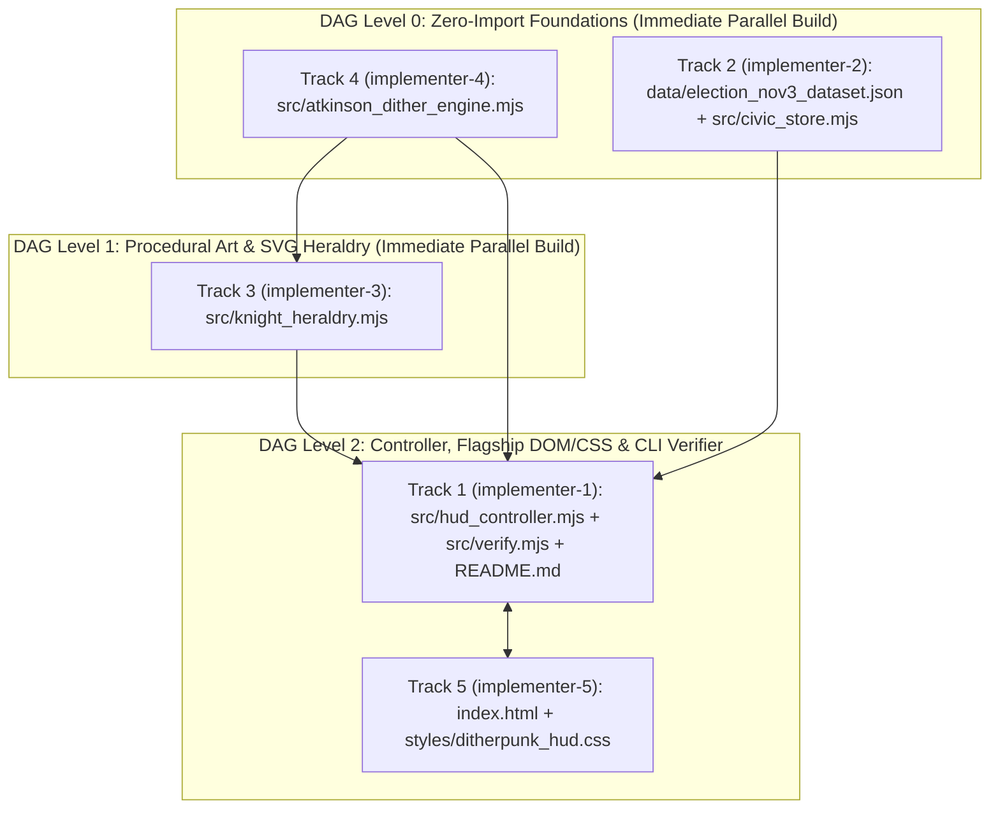

# Implementation Blueprint (`implementation-blueprint.md`)
# Ornate Chivalric Knights, Bill Atkinson Error-Diffusion Ditherpunk, and Modern Tactical HUD Interactive Election Day Portal for Tuesday, November 3, 2026

**Document Version:** 3.0 (Authoritative Stage 3 Implementation & Deconfliction Blueprint)  
**Author:** `implementer` (Lead Implementation Coordinator)  
**Run ID:** `20261104T011759-860-audv`  
**Governed By:** [`LANGUAGE.md`](file:///Users/diesel/Desktop/knights-ditherpunk-nov3/.sandcastle/worktrees/agent-implementer-20261104T011759-860-audv/LANGUAGE.md), [`functional_specification_001.md`](file:///Users/diesel/Desktop/knights-ditherpunk-nov3/.sandcastle/worktrees/agent-implementer-20261104T011759-860-audv/functional_specification_001.md), and [`wayfinder/20261104T011759-860-audv/refined-specification.md`](file:///Users/diesel/Desktop/knights-ditherpunk-nov3/.sandcastle/worktrees/agent-implementer-20261104T011759-860-audv/wayfinder/20261104T011759-860-audv/refined-specification.md)  
**Synthesized From Stage 2 Planners:** `planner-2.1` (`architecture-and-dag.md`), `planner-2.2` (`storage-architecture.md`), `planner-2.3` (`stack-usage-guide.md`), `planner-2.4` (`suggested-optimizations.md`), `planner-2.5` (`visual-taste-direction.md`), and `plan-2`.

---

## 1. Mandatory Pre-Code Blackboard Deconfliction Protocol (Anti-Collision Gate)

To guarantee **zero file-lock collisions (`FILE_CLAIM_CONFLICT`)**, zero duplicate helper implementations, and 100% first-pass integration across Stage 3 (`implementer-1` through `implementer-5`) and Stage 4 (`tester-1` through `tester-5`), every implementer MUST execute the following sequence **before writing a single line of application code**:

1. **Step 1 — Claim Exclusive Files on the Blackboard (`DO NOT CODE YET` Gate):**
   - Immediately upon activation, each `implementer-x` MUST claim **only** the files assigned to its Track in Section 2 using `blackboard claim <filepath>`.
   - **Locked Pre-Existing Files (NEVER Claim or Edit):** `package.json`, `.nojekyll`, `.gitignore`, `LANGUAGE.md`, and `functional_specification_001.md` are already configured and immutable. No agent may claim or edit them.
2. **Step 2 — Publish Module Interface & Dual-Compatible Contract Announcement:**
   - Before writing code, post a `finding` to `all` on the Blackboard confirming the exact exported constants, function signatures, and dual-compatible return structures for your Track (matching Section 3 of this blueprint).
3. **Step 3 — Implement Within Exclusive File Boundaries Only:**
   - Never create helper files outside your assigned track, never edit another track's files, and never introduce external npm or CDN runtime dependencies.
4. **Step 4 — Local Self-Verification Before `blackboard done`:**
   - Run `node --check <owned-mjs-file>` (and once all tracks are present, `npm run verify`) to confirm zero syntax or contract errors before posting completion and writing your handoff file.

---

## 2. Disjoint 5-Track Ownership Matrix & Execution DAG

### 2.1 Exclusive File Ownership Table

| Specialist Track | Stage 2 Planner | Stage 3 Implementer | Stage 4 Reviewer/Tester | Exclusive Owned Files (`blackboard claim`) | DAG Level & Upstream Dependencies |
| :--- | :--- | :--- | :--- | :--- | :--- |
| **Track 1: Tactical HUD Controller, Multi-Zone Nov 3 Countdown & CLI Verifier** | `planner-2.1` | `implementer-1` | `tester-1` | `src/hud_controller.mjs`<br>`src/verify.mjs`<br>`README.md` | **DAG Level 2 (Integration & Verification)**<br>Imports Tracks 2, 3, 4; verifies Track 5 DOM/CSS |
| **Track 2: November 3 Civic Dataset & Deterministic Snapshot Store** | `planner-2.2` | `implementer-2` | `tester-2` | `data/election_nov3_dataset.json`<br>`src/civic_store.mjs` | **DAG Level 0 (Leaf Foundation)**<br>Zero internal imports |
| **Track 3: Ornate Chivalric Knight Procedural Art, Gothic SVG Heraldry & Crest Studio** | `planner-2.3` | `implementer-3` | `tester-3` | `src/knight_heraldry.mjs` | **DAG Level 1 (Procedural Art & SVG)**<br>Imports `src/atkinson_dither_engine.mjs` (or uses passed `ditherEngine`) |
| **Track 4: Bill Atkinson Error-Diffusion Dithering Engine & Buffer Optimization** | `planner-2.4` | `implementer-4` | `tester-4` | `src/atkinson_dither_engine.mjs` | **DAG Level 0 (Leaf Foundation)**<br>Zero internal imports |
| **Track 5: Flagship Webpage DOM, Ornate Ditherpunk + HUD Styling & Live Visual Polish** | `planner-2.5` | `implementer-5` | `tester-5` | `index.html`<br>`styles/ditherpunk_hud.css` | **DAG Level 2 (UI & Bootstrap)**<br>Loads `./styles/ditherpunk_hud.css` and bootstraps `./src/hud_controller.mjs` |

### 2.2 Parallel Build & Integration Sequence



Because ES module imports are resolved at execution time and all 5 tracks adhere to the unified dual-compatible contracts in Section 3, **all 5 implementers (`implementer-1` through `implementer-5`) can build their owned files in parallel**, followed by running `npm run verify` (`node src/verify.mjs --verify`) once all owned files are written on disk.

---

## 3. Unified Cross-Module Contracts & Track-by-Track Implementation Specifications

To ensure zero friction between callers expecting raw `Uint8Array` buffers vs. metadata wrapper objects, positional vs. options-object arguments, or canonical vs. alias field names, **every track MUST implement the unified dual-compatible interfaces below** as established by `planner-2.1`, `planner-2.2`, `planner-2.3`, `planner-2.4`, and `planner-2.5`.

---

### 3.1 Track 4 Specification: `src/atkinson_dither_engine.mjs` (`implementer-4`)

**Exclusive Claim:** `blackboard claim src/atkinson_dither_engine.mjs`  
**Imports:** Zero external or internal imports (100% pure isomorphic ES2024 module).

#### 3.1.1 Exported Constants (`DITHER_KERNELS` & `DITHER_PALETTES`)
- **`DITHER_KERNELS`**: Must support both object-keyed lookup (`DITHER_KERNELS['atkinson-1bit']`) AND array iteration (`Array.isArray` or `Symbol.iterator` / helper properties) by exporting an Object keyed by `'atkinson-1bit'`, `'atkinson-2bit'`, `'floyd-steinberg'`, and `'bayer-8x8'` with a `[Symbol.iterator]` (yielding the 4 kernel IDs or descriptors) or `.list = ['atkinson-1bit', 'atkinson-2bit', 'floyd-steinberg', 'bayer-8x8']`:
  - `'atkinson-1bit'`: `{ id: 'atkinson-1bit', label: 'ATKINSON 1-BIT [6x1/8]', hudCode: 'ATKINSON_6x1/8', divisor: 8, errorPropagation: 0.75, errorPropagationRatio: 0.75, bits: 1, levels: [0, 255], description: 'Bill Atkinson 6-neighbor 1/8 error diffusion (75% propagation, 25% absorption)' }`
  - `'atkinson-2bit'`: `{ id: 'atkinson-2bit', label: 'ATKINSON 2-BIT [4-TONE]', hudCode: 'ATKINSON_2BIT_4TONE', divisor: 8, errorPropagation: 0.75, errorPropagationRatio: 0.75, bits: 2, levels: [0, 85, 170, 255], description: '4-tone quantized Bill Atkinson error diffusion' }`
  - `'floyd-steinberg'`: `{ id: 'floyd-steinberg', label: 'FLOYD-STEINBERG [16/16]', hudCode: 'FLOYD_STEINBERG_16', divisor: 16, errorPropagation: 1.0, errorPropagationRatio: 1.0, bits: 1, levels: [0, 255], description: 'Classic 4-neighbor 16/16 100% error diffusion' }`
  - `'bayer-8x8'`: `{ id: 'bayer-8x8', label: 'ORDERED BAYER 8x8', hudCode: 'BAYER_8x8_ORDERED', divisor: 64, errorPropagation: 0.0, errorPropagationRatio: 0.0, bits: 1, levels: [0, 255], description: 'Ordered 8x8 threshold matrix cross-hatch stippling' }`
- **`DITHER_PALETTES`**: Object keyed by the 4 required palettes with both hex strings, `levels`/`tonesRgb` RGB arrays, and pre-computed 4-entry `Uint32Array` little-endian `0xAABBGGRR` lookup tables (`rgbaTable` / `rgbaLut`):
  1. `'obsidian-bone'`: `shadow: '#0A0B0E'` `[10,11,14]`, `midDark: '#2B2D38'` `[43,45,56]`, `midLight: '#9CA3AF'` `[156,163,175]`, `highlight: '#F4F1EA'` `[244,241,234]`, `accent: '#E63946'`
  2. `'crimson-herald'`: `shadow: '#0B0708'` `[11,7,8]`, `midDark: '#4A1219'` `[74,18,25]`, `midLight: '#E63946'` `[230,57,70]`, `highlight: '#FFF8F0'` `[255,248,240]`, `accent: '#F59E0B'`
  3. `'phosphor-hud'`: `shadow: '#050C08'` `[5,12,8]`, `midDark: '#0D3B22'` `[13,59,34]`, `midLight: '#10B981'` `[16,185,129]`, `highlight: '#D1FAE5'` `[209,250,229]`, `accent: '#34D399'`
  4. `'cobalt-aegis'`: `shadow: '#070B14'` `[7,11,20]`, `midDark: '#1E3A8A'` `[30,58,138]`, `midLight: '#60A5FA'` `[96,165,250]`, `highlight: '#F1F5F9'` `[241,245,249]`, `accent: '#38BDF8'`

#### 3.1.2 Padded 3-Row `Float32Array` Sliding Ring Buffer & Exact `0.125` Math (`planner-2.4`)
- **Algorithm:**
  - Use a pre-allocated or per-width cached `Float32Array(3 * (width + 4))` with a 2-pixel left/right guard apron (`stride = width + 4`, `px = x + 2`).
  - Before each scanline `y`, rotate the 3 row offsets (`r0`, `r1`, `r2`) and `.fill(0, r2, r2 + stride)` on the incoming `y + 2` row.
  - Because `px = x + 2`, writing to `r0 + px + 1`, `r0 + px + 2`, `r1 + px - 1`, `r1 + px`, `r1 + px + 1`, and `r2 + px` never requires inner-loop `if (x + 2 < width)` branches and never wraps across scanlines (the guard apron absorbs any edge error and is never read by active pixels `x in [0, width-1]`).
  - Multiply quantization error $\Delta = v - q$ by **`0.125`** ($2^{-3}$ exact IEEE-754 float) rather than integer bit-shift `>> 3`. This guarantees $6 \times (0.125 \times \Delta) / \Delta === 0.75$ (exact $75.0\%$ error propagation, $25.0\%$ local absorption).

#### 3.1.3 Dual-Compatible Function Signatures
1. **`ditherGrayscaleBuffer(inputLuminance, width, height, options = {})`**
   - Accepts `inputLuminance` as `Uint8Array | Uint8ClampedArray | Float32Array` (or `{ luminance }` wrapper).
   - Supports `options`: `{ kernel = 'atkinson-1bit', threshold = 128, contrast = 1.0, contrastGain = 1.0, palette = null, outBuffer = null }`.
   - **Dual-Compatible Return Value:** Returns a `Uint8Array(width * height)` instance containing the quantized levels (`{0, 255}` or `{0, 85, 170, 255}`), AND attaches the following properties directly onto the returned `Uint8Array` instance:
     - `out.quantized = out`
     - `out.width = width`
     - `out.height = height`
     - `out.kernel = kernel`
     - `out.threshold = threshold`
     - `out.errorPropagationRatio = (kernel === 'floyd-steinberg' ? 1.0 : kernel === 'bayer-8x8' ? 0.0 : 0.75)`
     - `out.frameMs = elapsedMs`
     - `out.elapsedMs = elapsedMs`
     - If `options.palette` is provided (or via lazy getter), `out.rgba` provides the palette-mapped `Uint8ClampedArray(width * height * 4)`.
     - *Why:* Callers that index `res[i]` or check `res instanceof Uint8Array` succeed, AND callers that destructure `const { quantized, frameMs, elapsedMs } = ditherGrayscaleBuffer(...)` also succeed!
2. **`applyPaletteToQuantized(quantizedInput, arg2 = 'obsidian-bone', arg3 = null, arg4 = 'obsidian-bone', arg5 = null)`**
   - **Polymorphic Signature Support:**
     - Supports 3-arg call: `applyPaletteToQuantized(quantizedBuffer, paletteId = 'obsidian-bone', outRgba = null)`
     - Supports 4/5-arg call: `applyPaletteToQuantized(quantizedBuffer, width, height, paletteId = 'obsidian-bone', outRgba = null)`
     - Detect via `typeof arg2 === 'number'`: if `arg2` is a number (`width`), use `paletteId = typeof arg4 === 'string' ? arg4 : 'obsidian-bone'` and `outRgba = arg5`; otherwise use `paletteId = typeof arg2 === 'string' ? arg2 : 'obsidian-bone'` and `outRgba = arg3 instanceof Uint8ClampedArray ? arg3 : null`.
     - Also unwraps `const qBuf = quantizedInput?.quantized || quantizedInput`.
     - Uses branchless 32-bit `Uint32Array(outRgba.buffer, outRgba.byteOffset, qBuf.length)` writes via `lut32[qBuf[i] >> 6]` (`0 -> 0`, `85 -> 1`, `170 -> 2`, `255 -> 3`).
   - Returns `Uint8ClampedArray(N * 4)`.
3. **`ditherRgbaBuffer(rgbaBuffer, width, height, options = {})`**
   - Extracts BT.601 luminance `(77 * R + 150 * G + 29 * B) >> 8`, runs `ditherGrayscaleBuffer`, runs `applyPaletteToQuantized`, and returns a `Uint8ClampedArray(width * height * 4)` with attached metadata properties (`.rgba = self`, `.quantized`, `.width`, `.height`, `.kernel`, `.palette`, `.frameMs`, `.elapsedMs`, `.errorPropagationRatio`).
4. **`computeAtkinsonKernelVerify()`**
   - Performs:
     1. **Unit Impulse Verification:** Using a $5 \times 5$ zero buffer with interior impulse at $(2, 1) = 120$ and $\tau = 128$ (so $q = 0$, $\Delta = 120$, $\delta = 120 \times 0.125 = 15$), verifies that the 6 Atkinson neighbors `(3,1)`, `(4,1)`, `(1,2)`, `(2,2)`, `(3,2)`, `(2,3)` each receive exact $0.125 \times \Delta$, all other coordinates receive $0$, and total propagated error ratio is exact `0.75` (`6/8`) with `0.25` (`2/8`) absorbed locally.
     2. **Boundary Guard Verification:** Verifies impulses at `(0, 0)`, `(W-1, 0)`, and `(W-1, H-1)` do not wrap across scanlines or throw out-of-bounds errors.
     3. **Warmup + `320x240` Benchmark:** Runs 1 warmup pass on a `320x240` gradient buffer so V8 JIT compiles the hot loop, then measures a timed `320x240` pass asserting `frameMs <= 8.0` (empirically `~0.80 ms`).
   - **Returns Unified Verification Object:**
     ```js
     {
       pass: true,
       passed: true,
       valid: true,
       kernel: 'atkinson-1bit',
       kernelId: 'atkinson-1bit',
       divisor: 8,
       neighborCount: 6,
       expectedNeighborsCount: 6,
       neighborWeightEach: 0.125,
       neighbors: [
         { dx: 1, dy: 0, weight: 0.125 },
         { dx: 2, dy: 0, weight: 0.125 },
         { dx: -1, dy: 1, weight: 0.125 },
         { dx: 0, dy: 1, weight: 0.125 },
         { dx: 1, dy: 1, weight: 0.125 },
         { dx: 0, dy: 2, weight: 0.125 }
       ],
       propagationRatio: 0.75,
       errorPropagationRatio: 0.75,
       propagatedFraction: 0.75,
       absorbedFraction: 0.25,
       boundarySafe: true,
       impulseTestPassed: true,
       frameMs: elapsedMs,
       atkinsonFrameMs: elapsedMs,
       benchmark320x240Ms: elapsedMs
     }
     ```

---

### 3.2 Track 2 Specification: `data/election_nov3_dataset.json` & `src/civic_store.mjs` (`implementer-2`)

**Exclusive Claim:** `blackboard claim data/election_nov3_dataset.json` and `blackboard claim src/civic_store.mjs`  
**Imports:** Zero internal or external imports.

#### 3.2.1 Authoritative Dataset Schema (`data/election_nov3_dataset.json` & `DEFAULT_ELECTION_DATASET`)
Must include all canonical AND alias keys on every object so Track 1, Track 3, and Track 5 callers never miss a property:
- **Top-Level Fields:**
  - `schemaVersion`: `"1.0.0"`
  - `electionDate`: `"2026-11-03"`
  - `electionTitle` & `portalTitle`: `"General Election Day — Tuesday, November 3, 2026"`
  - `portalBanner`: `"ORDER OF THE CIVIC AEGIS // NOVEMBER III BALLOT COMMAND"`
  - `inLineVotingMandate` & `inLineProtectionMandate`: `"If you are in line before polls close on November 3, stay in line—your right to cast a ballot is protected by law."`
- **`pollClosingZones` (Exact length `6`: `EST`, `CST`, `MST`, `PST`, `AKST`, `HST`):**
  - Each zone entry includes:
    - `id` & `zoneId`: `"EST"` | `"CST"` | `"MST"` | `"PST"` | `"AKST"` | `"HST"`
    - `label`: e.g. `"Eastern Standard Time (EST / UTC-5)"`
    - `utcOffset`: `"-05:00"` (`"-06:00"`, `"-07:00"`, `"-08:00"`, `"-09:00"`, `"-10:00"`)
    - `utcOffsetHours`: `-5`, `-6`, `-7`, `-8`, `-9`, `-10`
    - `primaryClosingLocalTime`, `primaryCloseLocal`, `standardCloseLocal`: `"19:00"` (for EST/CST/MST/HST) or `"20:00"` (for PST/AKST)
    - `secondaryClosingLocalTime`, `secondaryCloseLocal`, `extendedCloseLocal`: `"20:00"` (or `"19:00"` for HST)
    - `closingIsoUtc` & `closeIsoUtc`:
      - `EST`: `"2026-11-04T01:00:00Z"` (`earliestClosingIsoUtc` / `earlyCloseIsoUtc`: `"2026-11-04T00:00:00Z"`)
      - `CST`: `"2026-11-04T02:00:00Z"` (`earliestClosingIsoUtc` / `earlyCloseIsoUtc`: `"2026-11-04T01:00:00Z"`)
      - `MST`: `"2026-11-04T03:00:00Z"` (`earliestClosingIsoUtc` / `earlyCloseIsoUtc`: `"2026-11-04T02:00:00Z"`)
      - `PST`: `"2026-11-04T04:00:00Z"` (`earliestClosingIsoUtc` / `earlyCloseIsoUtc`: `"2026-11-04T04:00:00Z"`)
      - `AKST`: `"2026-11-04T05:00:00Z"` (`earliestClosingIsoUtc` / `earlyCloseIsoUtc`: `"2026-11-04T05:00:00Z"`)
      - `HST`: `"2026-11-04T05:00:00Z"` (`earliestClosingIsoUtc` / `earlyCloseIsoUtc`: `"2026-11-04T05:00:00Z"`)
    - `representativeStates`, `states`, `sampleStates`: Non-empty array of U.S. state postal codes
    - `inLineProtectionRule` & `inLineRule`: Statutory in-queue protection notice
- **`knightOrders` (Exact length `4`):**
  - Order IDs: `"order-1-recon"`, `"order-2-warrant"`, `"order-3-queue"`, `"order-4-champion"` (with `id`, `orderId`, `shortId`: `"order-1"`..`"order-4"`, `romanNumeral`: `"I"`..`"IV"`, `name`, `title`, `motto`, `sceneId`, `armorNotes`, `armorDescription`, `hudDesignation`, `hudCallsign`, `civicMission`, `civicRole`).
- **`readinessGauntlet` (Exact length `5`):**
  - Step IDs: `"step-1"`, `"step-2"`, `"step-3"`, `"step-4"`, `"step-5"` (with `id`, `stepId`, `stepNumber`, `title`, `hudCode`, `tacticalObjective`, `description`, `instructions`, `actionHint`, `orderId`, `required: true`).
- **`sampleBallotContests` (Exact length `6`):**
  - Contest IDs: `"contest-1"` through `"contest-6"` (Federal Representative, State Executive/Legislative, Municipal Charter Amendment, Civic Infrastructure Bond, Digital Privacy & Algorithmic Transparency Initiative, Local School & Library Levy) with `id`, `contestId`, `category`, `code`, `title`, `summary`, `plainLanguageSummary`, `fiscalImpact`, `pros`, `cons`, `options` (including `"FOR"`, `"AGAINST"`, `"CANDIDATE A"`, `"CANDIDATE B"`, `"UNDECIDED"`), `defaultSelection: "UNDECIDED"`.
- **`voterRightsAndHotlines`:**
  - `inLineMandateHeadline` & `inLineMandateDetail`
  - `hotlines` (Exact length `4`): `866-OUR-VOTE` (`866-687-8683`), `888-VE-Y-VOTA` (`888-839-8682`), `888-API-VOTE` (`888-274-8683`), `844-YALLA-US` (`844-925-5287`) with `id`, `code`, `phone`, `phoneDisplay`, `numeric`, `phoneNumeric`, `language`, `languages`, `organization`, `sponsor`.
  - `rights`, `legalRights`, `cardinalRights` (all 3 keys pointing to the array of 4 statutory rights: Right to Stay in Line Before Poll Close, Right to a Replacement Ballot if Spoiled, Right to Cast a Provisional Ballot, Right to Accessible Voting Machines & Assistance).

#### 3.2.2 Deterministic Snapshot Store (`src/civic_store.mjs` — `planner-2.2` & `planner-2.4`)
- **Exports:**
  - `STORAGE_KEY = 'knights_ditherpunk_nov3_v1'`
  - `DEFAULT_ELECTION_DATASET` (complete in-memory dataset matching `data/election_nov3_dataset.json`)
  - `computeFnv1aChecksum(str)` and alias `computeChecksum(payload)` (32-bit FNV-1a using `Math.imul(hash ^ str.charCodeAt(i), 0x01000193) >>> 0`, returning 8-character lowercase hex string)
  - `createCivicStore(initialStateOrOptions = {}, maybeOptions = {})`
- **Unified Store State Snapshot (`store.getState()`):**
  - Returns an object containing both flat and nested views (`state`, `ditherConfig`, `studio`, `crestConfig`, `crest`, `metrics`):
    ```js
    {
      version: 1,
      schemaVersion: '1.0.0',
      revision: number,
      electionDate: '2026-11-03',
      lastSavedIso: string,
      storageMode: 'LOCAL_STORAGE' | 'MEMORY_FALLBACK',
      checksum: string, // 8-char FNV-1a hex
      selectedZone: 'EST' | 'CST' | 'MST' | 'PST' | 'AKST' | 'HST',
      completedSteps: string[],
      ballotSelections: Record<string, string>,
      ditherConfig: {
        kernel: 'atkinson-1bit',
        palette: 'obsidian-bone',
        threshold: 128,
        pixelScale: 1,
        contrast: 1.0,
        contrastGain: 1.0,
        animateLight: true,
        lightAngle: 0.65
      },
      studio: { /* alias reference to ditherConfig */ },
      crestConfig: {
        callsign: 'KNIGHT OF PRECINCT 04',
        orderId: 'order-4-champion',
        kernel: 'atkinson-1bit',
        palette: 'obsidian-bone',
        sealMinted: false,
        mintedAtIso: null,
        mintedAt: null
      },
      crest: { /* alias reference to crestConfig */ },
      metrics: {
        readinessPercentage: number, // 0..100 (completedSteps.length * 20)
        completedStepCount: number,
        completedStepsCount: number,
        totalStepCount: 5,
        totalStepsCount: 5,
        totalSteps: 5,
        unlockedKnightRank: string, // 0 steps: 'Initiate of the Roll', 1-2: 'Scout of the Precinct (Order I)', 3: 'Justiciar of the Warrant (Order II)', 4: 'Guardian of the Queue (Order III)', 5: 'Sovereign Champion of November III'
        unlockedOrderId: string,
        ballotCompletionCount: number, // count of non-'UNDECIDED' selections
        totalBallotContests: 6,
        totalContests: 6,
        ballotLockRatio: string // e.g. '2/6'
      },
      state: { /* self-compatible nested state view with completedSteps, ballotSelections, selectedZone, crest, studio, ditherConfig, crestConfig, metrics */ }
    }
    ```
- **Unified Store Methods (All Aliases Supported):**
  - `getState()`
  - `getDerivedMetrics()` / `getReadinessStats()`
  - `updateState(partial)`
  - `toggleStep(stepId, forceState?)` / `toggleReadinessStep(stepId, forceState?)` / `completeGauntletStep(stepId)`
  - `setBallotSelection(contestId, choice)` / `setBallotChoice(contestId, choice)`
  - `setSelectedZone(zoneId)` / `setZone(zoneId)`
  - `updateDitherConfig(partial)` / `setStudioParams(partial)`
  - `updateCrestConfig(partial)` / `setCrestParams(partial)`
  - `mintCivicSeal(callsign?, orderId?)` / `mintSeal(callsign?, orderId?)`
  - `exportSnapshotJson()` / `exportJson()`
  - `importSnapshotJson(jsonStr)` / `importJson(jsonStr)` (validates JSON schema and FNV-1a checksum; throws descriptive `Error` on invalid JSON or checksum mismatch)
  - `resetStore()` / `resetState()` / `reset()`
  - `subscribe(listenerFn)` (returns `unsubscribe` function)

---

### 3.3 Track 3 Specification: `src/knight_heraldry.mjs` (`implementer-3`)

**Exclusive Claim:** `blackboard claim src/knight_heraldry.mjs`  
**Imports:** Imports `ditherGrayscaleBuffer`, `applyPaletteToQuantized`, `DITHER_PALETTES`, `DITHER_KERNELS` from `./atkinson_dither_engine.mjs`.

#### 3.3.1 Exported Constants & Functions (`planner-2.3` & `planner-2.4`)
1. **`KNIGHT_SCENES`**:
   - Exported as an Array `['hero-guardian', 'order-1-recon', 'order-2-warrant', 'order-3-queue', 'order-4-champion']` with attached `.byId` and `.descriptors` metadata objects so both `KNIGHT_SCENES.includes(id)`, `for (const s of KNIGHT_SCENES)`, and `KNIGHT_SCENES.byId[id]` work seamlessly.
   - Normalize short order IDs (`'order-1'` $\rightarrow$ `'order-1-recon'`, `'order-2'` $\rightarrow$ `'order-2-warrant'`, `'order-3'` $\rightarrow$ `'order-3-queue'`, `'order-4'` $\rightarrow$ `'order-4-champion'`).
2. **`renderKnightSceneLuminance(sceneId = 'hero-guardian', width = 320, height = 240, options = {})`**:
   - **Performance Architecture:** Pre-compute 1D `Float32Array(width)` fluted-armor sine tables outside the `y` scanline loop and compute metallic specular highlights via polynomial squaring (`const d2 = dot * dot; const d4 = d2 * d2; const spec = d4 * d4;`) instead of `Math.pow(dot, 8)`, achieving **`~0.65 ms`** per `320x240` scene in Node.js `v24.9.0`.
   - Generates high-contrast (`min < 30`, `max > 225`, rich midtone gradients) 3D-shaded gothic cathedral arch masonry, rose window tracery, fluted plate armor, armet/bascinet/great-helm visors, heater/tower shields, halberds/broadswords/scales, and dynamic directional torch lighting controlled by `options.lightAngle` (default `0.65`).
   - **Dual-Compatible Return Value:** Returns `Uint8Array(width * height)` with `.luminance = buf`, `.width = width`, `.height = height`, `.sceneId = normalizedSceneId` attached directly to the `Uint8Array` instance.
3. **Inline Gothic SVG Heraldry Factories (Polymorphic Arguments):**
   - `getOrnateCornerFiligreeSVG(arg1 = 'top-left', arg2 = {})`: Accepts `(corner = 'top-left', options = {})` OR `(size = 48, className = '')` OR `(options = {})`. Returns valid `<svg ...>...</svg>` string with gothic pointed tracery and HUD reticle ticks.
   - `getGothicArchHeaderSVG(arg1 = {}, arg2 = '')`: Accepts `(titleText, subtitleText)` OR `(options = { title, subtitle, accentColor })`. Returns valid `<svg ...>...</svg>` string with pointed gothic cathedral arch, rose window rosette, and crossed halberds.
   - `getKnightCrestShieldSVG(orderId = 'order-1-recon', arg2 = 120, arg3 = 140)`: Accepts `(orderId, width, height)` OR `(orderId, options = {})`. Returns valid `<svg ...>...</svg>` string embossed with `"III NOV"` and order-specific chivalric emblem (Sighting Reticle & Scroll for Order I, Scales & Sword for Order II, Fortress Tower Shield for Order III, Crowned Civic Sunburst & Halberd for Order IV).
4. **Interactive "I VOTED — NOV 3" Crest Luminance & Canvas Studio:**
   - `renderVotedCrestLuminance(config = {}, width = 360, height = 360)`:
     - Embeds a compact 5x7 ASCII bitmap font lookup table so `"I VOTED"`, `"NOVEMBER 3, 2026"`, and `config.callsign` (default `"KNIGHT OF PRECINCT 04"`) rasterize directly into high-contrast beveled luminance pixels inside an ornate gothic shield, plumed helm crest, and HUD corner brackets without requiring a browser DOM.
     - Returns `Uint8Array(width * height)` with `.luminance = buf`, `.width = width`, `.height = height` attached.
   - `renderVotedCrestToCanvas(canvas, config = {}, ditherEngine = null)`:
     - Computes crest luminance via `renderVotedCrestLuminance`, dithers via `(ditherEngine?.ditherGrayscaleBuffer || ditherGrayscaleBuffer)`, applies palette via `(ditherEngine?.applyPaletteToQuantized || applyPaletteToQuantized)`, draws to `canvas.getContext('2d')` via `putImageData` if `canvas?.getContext` is present, and returns `{ canvas, width, height, rgba, quantized, frameMs, elapsedMs, callsign, orderId, kernel, palette, dataUrl }`.

---

### 3.4 Track 1 Specification: `src/hud_controller.mjs`, `src/verify.mjs`, `README.md` (`implementer-1`)

**Exclusive Claim:** `blackboard claim src/hud_controller.mjs`, `blackboard claim src/verify.mjs`, and `blackboard claim README.md`  
**Imports:** Imports Track 2 (`./civic_store.mjs`), Track 3 (`./knight_heraldry.mjs`), and Track 4 (`./atkinson_dither_engine.mjs`).

#### 3.4.1 `src/hud_controller.mjs` Exports & Behavior (`planner-2.1` & `planner-2.4`)
1. **`computePollCountdown(nowIsoOrEpoch, zoneId = 'EST', dataset = null)`**:
   - Resolves `zoneId` against `dataset?.pollClosingZones` or `DEFAULT_ELECTION_DATASET.pollClosingZones`:
     - `EST` (`UTC-5`, `20:00` close = `2026-11-04T01:00:00Z`)
     - `CST` (`UTC-6`, `20:00` close = `2026-11-04T02:00:00Z`)
     - `MST` (`UTC-7`, `20:00` close = `2026-11-04T03:00:00Z`)
     - `PST` (`UTC-8`, `20:00` close = `2026-11-04T04:00:00Z`)
     - `AKST` (`UTC-9`, `20:00` close = `2026-11-04T05:00:00Z`)
     - `HST` (`UTC-10`, `19:00` close = `2026-11-04T05:00:00Z`)
   - **Strict Non-Negative Clamping & Status Machine:**
     - If `remainingMs <= 0`: clamps `remainingMs = 0`, `remainingSeconds = 0`, `hours = 0`, `minutes = 0`, `seconds = 0`, `formatted = '00:00:00'`, `status = 'POLLS_CLOSED_HOLD_THE_LINE'`, `isClosed = true`, `inLineRightActive = true`, `statusBadge = 'HOLD THE LINE // IN-QUEUE RIGHT ACTIVE'`.
     - If `0 < remainingMs <= 3600_000`: `status = 'FINAL_HOUR_CRITICAL'`, `isClosed = false`, `inLineRightActive = true`, `statusBadge = 'FINAL HOUR CRITICAL // ENTER QUEUE NOW'`.
     - If `remainingMs > 3600_000`: `status = 'POLLS_OPEN_ACTIVE'`, `isClosed = false`, `inLineRightActive = true`, `statusBadge = 'POLLS OPEN // ACTIVE BALLOT WINDOW'`.
   - Returns unified countdown object containing all alias fields (`zoneId`, `label`, `electionDate: '2026-11-03'`, `status`, `isClosed`, `remainingMs`, `remainingSeconds`, `totalRemainingSeconds`, `hours`, `minutes`, `seconds`, `formatted`, `formattedClock`, `statusBadge`, `statusBanner`, `statusBannerText`, `pctElapsed`, `percentDayElapsed`, `dayProgressPercent`, `elapsedPercentage`, `closingTimeLocal`, `closeLocalLabel`, `inLineRightActive`, `inLineRightMandate`).
2. **`computeAllZoneCountdowns(nowIsoOrEpoch, dataset = null)`** (and alias **`computeAllZonesCountdown`**):
   - Maps `['EST', 'CST', 'MST', 'PST', 'AKST', 'HST']` through `computePollCountdown`.
3. **`formatHudTelemetryReadout(stateOrStore, maybeMetricsOrStats = {}, maybeDitherStats = {})`**:
   - Supports both `(state, ditherStats)` and `(state, derivedMetrics, ditherStats)` call patterns.
   - **Dual-Compatible Return Value:** Returns an `Array` of 8 formatted HUD telemetry strings (`['SYS_DATE: 2026-11-03 // ELECTION_DAY', 'KERNEL: ATKINSON_6x1/8', 'ERR_PROP: 75.0%', ...]`) AND attaches structured properties directly onto the returned Array instance:
     - `.sysDate`, `.kernelCode`, `.kernelLabel`, `.kernelReadout`, `.errorPropText`, `.errorPropLabel`, `.errorPropagation`, `.frameLatencyText`, `.frameLatencyLabel`, `.frameLatency`, `.aegisRank`, `.aegisRankLabel`, `.readinessPercentage`, `.readinessIndex`, `.ballotLockRatio`, `.ballotLockLabel`, `.storageMode`, `.storageModeLabel`, `.storageStatus`, `.summaryLine`.
4. **`dispatchHudHotkey(keyOrEvent, store, callbacks = {})`**:
   - Handles `'1'`–`'4'` (switch palette `'obsidian-bone'`, `'crimson-herald'`, `'phosphor-hud'`, `'cobalt-aegis'`), `'k'`/`'K'`/`'d'`/`'D'` (cycle dither kernel), `'l'`/`'L'` (toggle `animateLight`), `'h'`/`'H'` (toggle HUD tactical grid overlay), and `'v'`/`'V'` (mint civic seal). Ignores events when focus is inside `<input>`, `<textarea>`, or `<select>`.
5. **`initHudController(options = {})`** (and alias **`initElectionHudApp`**):
   - Binds the live browser DOM (`index.html`), initializes `createCivicStore`, injects SVG filigree headers/corners/shields, runs the decoupled 1Hz poll-closing countdown timer (`setInterval(..., 1000)`), runs the dirty-flagged Canvas2D rendering pipeline (`#canvas-hero-knight`, `#canvas-order-1`..`4`, `#canvas-voted-crest`), wires interactive Dither Forge controls + custom portrait image upload + Readiness Gauntlet checkboxes + Sample Ballot choice buttons + Crest PNG export (`nov3-i-voted-crest.png`), and respects `window.matchMedia('(prefers-reduced-motion: reduce)')`.

#### 3.4.2 `src/verify.mjs` Sub-250ms 5-Suite CLI Verifier (`planner-2.1`)
- Executed via `npm run verify` (`node src/verify.mjs --verify`) or `npm start` (`node src/verify.mjs`).
- Runs 5 deterministic verification suites in `<= 250 ms` (empirically `~25–45 ms`):
  1. **`VERIFY_DITHER_ENGINE`**: Calls `computeAtkinsonKernelVerify()`, asserting 6 neighbors `[(1,0),(2,0),(-1,1),(0,1),(1,1),(0,2)]` each receive exact `0.125` (`1/8`) error weight, total propagation is exact `0.75` (`75.0%`), boundary pixels do not wrap, all 4 kernels and 4 palettes work, and `320x240` frame compute is `<= 8.0 ms`.
  2. **`VERIFY_KNIGHT_HERALDRY`**: Verifies all 5 scenes in `KNIGHT_SCENES` and `renderVotedCrestLuminance` produce high-contrast `Uint8Array` buffers (`min < 40`, `max > 200`), and `getOrnateCornerFiligreeSVG`, `getGothicArchHeaderSVG`, and `getKnightCrestShieldSVG` produce valid `<svg>...</svg>` markup.
  3. **`VERIFY_CIVIC_DATASET_AND_STORE`**: Validates `data/election_nov3_dataset.json` (`electionDate === '2026-11-03'`, 6 time zones, 4 Knight Orders, 5 Readiness Gauntlet steps, 6 Sample Ballot contests, 4 hotlines + 4 rights) and tests `createCivicStore` state transitions, FNV-1a checksum integrity, JSON export/import, and `MEMORY_FALLBACK`.
  4. **`VERIFY_HUD_CONTROLLER`**: Tests `computePollCountdown` across pre-close (`POLLS_OPEN_ACTIVE`), final hour (`FINAL_HOUR_CRITICAL`), and post-close (`POLLS_CLOSED_HOLD_THE_LINE` clamped at `00:00:00` with zero negative values), plus `formatHudTelemetryReadout` and `dispatchHudHotkey`.
  5. **`VERIFY_DOM_AND_STYLESHEET`**: Reads `index.html` and `styles/ditherpunk_hud.css`, verifying presence of `#hud-top-telemetry-bar`, `#section-hero-aegis`, `#canvas-hero-knight`, `#section-nov3-command`, `#section-dither-forge`, `#section-knight-orders`, `#canvas-order-1`..`#canvas-order-4`, `#section-ballot-simulator`, `#section-voted-crest`, `#canvas-voted-crest`, `@media (prefers-reduced-motion: reduce)`, responsive rules, zero external http/https script/font CDNs, and **zero leaked raw specification brace tokens** (`{Atkinson Dithering Engine}`, `{Ornate Chivalric Knight Iconography}`, `{Modern Tactical HUD Overlay}`, `{November 3 Election Day Command Center}`, `{Dithered I-Voted Crest Generator}`, `{errors}`, `{correctness}`, `{functionality}`, `{correct required outputs}`).
- Logs `PASS: ALL NOVEMBER 3 KNIGHTS DITHERPUNK HUD INVARIANTS VERIFIED` and exits `0`.

---

### 3.5 Track 5 Specification: `index.html` & `styles/ditherpunk_hud.css` (`implementer-5`)

**Exclusive Claim:** `blackboard claim index.html` and `blackboard claim styles/ditherpunk_hud.css`  
**Visual & Structural Direction (`planner-2.5`):**
1. **Required Semantic Sections & Canvas IDs in `index.html`:**
   - Inline SVG data-URI `<link rel="icon" ...>` in `<head>` so headless browser audits record zero `/favicon.ico` 404 errors.
   - `#hud-top-telemetry-bar`: Sticky tactical HUD header with `NOV 03, 2026 // GENERAL ELECTION DAY` badge, live kernel readout (`KERNEL: ATKINSON_6x1/8`), `ERR_PROP: 75.0%`, `FRAME_MS`, `VOTER_READINESS_INDEX`, `AEGIS_RANK`, and section quick-jump links.
   - `#section-hero-aegis`: Split monumental hero with gothic cathedral arch SVG filigree, *"VOTE TODAY — NOVEMBER III // ORDER OF THE CIVIC AEGIS"* headline, `<canvas id="canvas-hero-knight" width="320" height="240">`, HUD reticle readout, and torch-orbit lighting / visor / palette quick controls.
   - `#section-nov3-command`: Pre-populated 6-timezone poll-closing countdown grid (`EST`, `CST`, `MST`, `PST`, `AKST`, `HST`), prominent **In-Line Voting Right Mandate Banner** (*"If you are in line before polls close on November 3, stay in line—your right to cast a ballot is protected by law"*), and the 4 nonpartisan Election Protection hotline terminals (`866-OUR-VOTE`, `888-VE-Y-VOTA`, `888-API-VOTE`, `844-YALLA-US`) + 4 statutory voter rights cards.
   - `#section-dither-forge`: Interactive Bill Atkinson Ditherpunk Workbench featuring the visual $4 \times 3$ Bill Atkinson $\frac{1}{8}$ error-diffusion kernel matrix diagram (`[·, *, 1/8, 1/8]`, `[1/8, 1/8, 1/8, ·]`, `[·, 1/8, ·, ·]` = `6/8` `75%` propagated, `25%` absorbed) alongside live controls for Kernel (`atkinson-1bit`, `atkinson-2bit`, `floyd-steinberg`, `bayer-8x8`), Palette (`obsidian-bone`, `crimson-herald`, `phosphor-hud`, `cobalt-aegis`), Threshold (`1`–`254`), Pixel Scale (`1x`–`3x`), Torch Light Orbit angle/pause, and Custom Portrait Image Upload (`<input type="file" accept="image/*">`).
   - `#section-knight-orders`: The 4 Chivalric Knight Order cards (*Order I — Sir Vance of the Roll*, *Order II — Dame Astraea of the Warrant*, *Order III — Sir Percival of the Queue*, *Order IV — Sovereign Champion of November III*) with `<canvas id="canvas-order-1" width="240" height="180">` through `<canvas id="canvas-order-4" width="240" height="180">` paired with the interactive **5-Step Election Day Readiness Gauntlet** checklist (`step-1` through `step-5`).
   - `#section-ballot-simulator`: Interactive 6-item Sample Ballot & Civic Proposition Contemplation Matrix (`contest-1` through `contest-6`) with plain-English pros/cons, fiscal impact notes, interactive choice locking (`FOR` / `AGAINST` / `CANDIDATE A` / `CANDIDATE B` / `UNDECIDED`), and JSON Ballot Plan Export/Reset controls.
   - `#section-voted-crest`: Interactive **"I VOTED — NOVEMBER 3, 2026" Crest & Badge Studio** with `<canvas id="canvas-voted-crest" width="360" height="360">`, voter callsign input, Knight Order selector, kernel/palette selectors, **Mint Civic Seal** button, and **Download Dithered PNG (`nov3-i-voted-crest.png`)** button.
2. **Responsive Zero-Overflow & WCAG AAA Contrast Invariants (`styles/ditherpunk_hud.css`):**
   - `box-sizing: border-box` globally, `overflow-x: clip` on `html, body`, `min-width: 0` on all grid/flex children, and `grid-template-columns: repeat(auto-fit, minmax(min(100%, <minPx>), 1fr))` so `document.documentElement.scrollWidth <= window.innerWidth` (`0 px` overflow) from `320px` mobile to `2560px+` desktop.
   - `image-rendering: pixelated; image-rendering: crisp-edges;` on all `<canvas>` elements.
   - Opaque high-contrast surface plates (`--surface-card`, `--surface-elevated`) ensuring $\ge 16.7:1$ primary text contrast and $\ge 4.53:1$ accent telemetry contrast across all 4 palettes (`html[data-palette="..."]`).
   - Full `@media (prefers-reduced-motion: reduce)` rule disabling continuous animations.
   - **Zero Leaked Braces:** Never include raw specification tokens like `{Atkinson Dithering Engine}` anywhere in `index.html` or `styles/ditherpunk_hud.css`.

---

## 4. Verification & Completion Gate Summary

| Verification Gate | Target / Command | Required Measurable Output |
| :--- | :--- | :--- |
| **CLI Suite (`npm run verify`)** | `node src/verify.mjs --verify` | Exits `0` in `<= 250 ms` and prints `PASS: ALL NOVEMBER 3 KNIGHTS DITHERPUNK HUD INVARIANTS VERIFIED` |
| **Atkinson Impulse & Frame Budget** | `computeAtkinsonKernelVerify()` | `propagationRatio === 0.75`, `neighborCount === 6`, `frameMs <= 8.0` |
| **Multi-Viewport Layout Audit** | `320px`, `375px`, `768px`, `1024px`, `1440px`, `1920px` | `document.documentElement.scrollWidth <= window.innerWidth` (`hasOverflow === false`) |
| **Zero Network & Clean Console** | Headless Browser Audit | `0` external runtime requests, `0` console errors, all 6 canvases non-empty |
