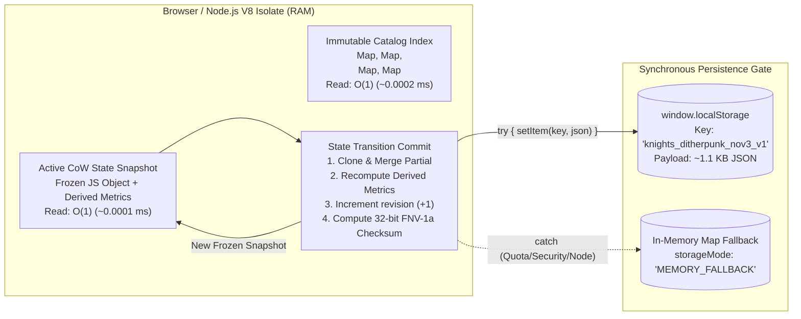
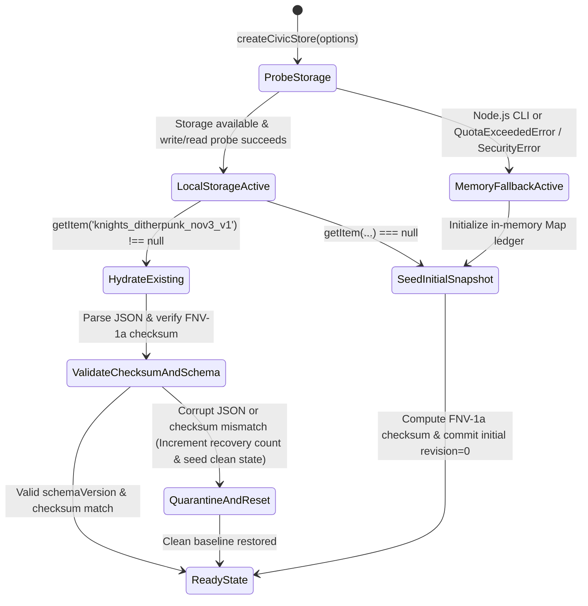

# Storage Engine & Data-Consistency Architecture (`storage-architecture.md`)

**Document Version:** 1.0  
**Run ID:** `20261104T011759-860-audv`  
**Author:** `planner-2.2` (Storage Engine & Consistency Architect — Track 2)  
**Governed By:** [`LANGUAGE.md`](file:///Users/diesel/Desktop/knights-ditherpunk-nov3/.sandcastle/worktrees/agent-planner-2.2-20261104T011759-860-audv/LANGUAGE.md), [`functional_specification_001.md`](file:///Users/diesel/Desktop/knights-ditherpunk-nov3/.sandcastle/worktrees/agent-planner-2.2-20261104T011759-860-audv/functional_specification_001.md), & [`wayfinder/20261104T011759-860-audv/refined-specification.md`](file:///Users/diesel/Desktop/knights-ditherpunk-nov3/.sandcastle/worktrees/agent-planner-2.2-20261104T011759-860-audv/wayfinder/20261104T011759-860-audv/refined-specification.md)  
**Exclusive Track 2 File Ownership (`implementer-2` / `tester-2`):**  
- `data/election_nov3_dataset.json`  
- `src/civic_store.mjs`

---

## 1. Executive Summary & Architectural Scope

This document defines the persistence layer, storage engine physics, concurrency control protocol, isolation guarantees, crash recovery mechanics, and authoritative data schemas for the **Ornate Chivalric Knights + Bill Atkinson Error-Diffusion Ditherpunk + Modern Tactical HUD Election Day Portal (Tuesday, November 3, 2026)**.

Per Section 3.1 and Section 5 of `refined-specification.md`, the application operates under two non-negotiable physical invariants:
1. **Zero External Runtime Network Dependencies (`0` external APIs / `0` remote databases):** The entire persistence layer must execute 100% locally in both browser environments (HTTP static server, GitHub Pages, or restrictive `file://` origin) and headless Node.js `v24.9.0` CLI verification (`npm run verify`).
2. **Deterministic Sub-Millisecond Latency Budget (`<= 250 ms` total CLI verification wall-clock; `<= 8.0 ms` per-frame `320x240` Atkinson dither compute):** Persistence reads and writes must never block the 60–120 FPS animation loop or exceed sub-millisecond execution in `src/verify.mjs`.

To satisfy these constraints from first principles, Track 2 separates data into two distinct storage tiers:
- **Tier 1 — Immutable Static Reference Catalog (`data/election_nov3_dataset.json` + `DEFAULT_ELECTION_DATASET` in `src/civic_store.mjs`):** A read-only, schema-versioned (`1.0.0`) reference catalog anchored to `"2026-11-03"`, indexed in memory via $O(1)$ hash maps at initialization.
- **Tier 2 — Mutable Deterministic Snapshot Store (`src/civic_store.mjs`):** A Copy-on-Write (CoW), single-key atomic document snapshot store backed by `window.localStorage` (`"knights_ditherpunk_nov3_v1"`) with automatic, zero-exception failover to an in-memory `Map` ledger (`storageMode: "MEMORY_FALLBACK"`), protected by monotonic revision counters (`revision`) and 32-bit FNV-1a integrity checksums (`checksum`).

---

## 2. Storage Engine Physics, Access Patterns & Amplification Trade-Offs

### 2.1 Workload Characterization & Physical Sizing
Before selecting a storage structure, we model the exact cardinality, payload byte size, and read/write frequency of every entity in the portal:

| Data Entity | Mutability | Cardinality | Serialized Payload Size | Read Frequency | Write Frequency |
| :--- | :--- | :--- | :--- | :--- | :--- |
| **`pollClosingZones`** | Immutable | `6` zones (`EST`, `CST`, `MST`, `PST`, `AKST`, `HST`) | `~2.1 KB` | `1 Hz` (HUD countdown tick) + instant zone switch | `0` (Read-only) |
| **`knightOrders`** | Immutable | `4` orders (`order-1-recon` .. `order-4-champion`) | `~1.8 KB` | On render / tab switch / crest select | `0` (Read-only) |
| **`readinessGauntlet`** | Immutable Catalog + Mutable Set | `5` steps (`step-1` .. `step-5`) | Catalog: `~1.4 KB`<br>State array: `<= 60 B` | Every HUD telemetry format call | Low (`~5–20` clicks per session) |
| **`sampleBallotContests`** | Immutable Catalog + Mutable Map | `6` contests (`contest-1` .. `contest-6`) | Catalog: `~2.8 KB`<br>State map: `<= 180 B` | Every ballot card interaction & HUD update | Low (`~6–30` clicks per session) |
| **`voterRightsAndHotlines`** | Immutable | `4` hotlines + `4` statutory rights | `~2.2 KB` | Initial DOM mount & modal inspect | `0` (Read-only) |
| **`ditherConfig` / `studio`** | Mutable State | `7` scalar fields (`kernel`, `palette`, `threshold`, `pixelScale`, `contrastGain`, `lightAngle`, `animateLight`) | `~190 B` | `60 Hz` (Every animation/render frame) | Burst (`1–60 Hz` during slider drag / orbit) |
| **`crestConfig` / `crest`** | Mutable State | `6` scalar fields (`callsign`, `orderId`, `kernel`, `palette`, `sealMinted`, `mintedAtIso`) | `~210 B` | On crest studio render & PNG export | Low (`~1–15` edits per session) |
| **Total Snapshot Envelope** | Mutable Snapshot | `1` composite document | **`~950 B – 1,350 B` (`< 1.5 KB`)** | `60 Hz` in-memory (`O(1)` reference) | `~0.1 – 5 Hz` committed to storage |

### 2.2 Storage Structure Trade-Off Analysis: In-Memory + Atomic Single-Key Document vs. B+Tree vs. LSM-Tree



We evaluate three candidate storage engine architectures against this exact physical workload:

| Storage Engine Architecture | Read Amplification ($R_{amp}$) | Write Amplification ($W_{amp}$) | Space Amplification ($S_{amp}$) | Latency & Architectural Fit |
| :--- | :--- | :--- | :--- | :--- |
| **1. B+Tree Page Store (`IndexedDB` / SQLite-WASM)** | **High for tiny state:** Requires async IPC across browser process boundaries + B+Tree page traversal ($4\text{ KB}–16\text{ KB}$ page reads for $1.1\text{ KB}$ payload). | **High ($W_{amp} \approx 4\times–16\times$):** Modifying a 20-byte ballot choice rewrites a full $4\text{ KB}$ B+Tree leaf page + WAL frame. | **High:** Minimum page allocation + B+Tree internal node pointers + SQLite/IndexedDB metadata overhead ($> 32\text{ KB}$ for $1.1\text{ KB}$ data). | **REJECTED.** `IndexedDB` is asynchronous, which breaks synchronous deterministic state assertions in `src/verify.mjs` and introduces event-loop race conditions during rapid hotkey dispatching (`[1-4]`, `[K]`, `[L]`). |
| **2. Log-Structured Merge-Tree (LSM-Tree / Append-Only Mutation Log in `localStorage`)** | **Degrades over time ($O(N)$ log replay):** Reading state requires scanning or compacting historical mutation log keys (`log_001..log_k`). | **Low per append ($W_{amp} \approx 1\times$)** until compaction, then spikes during log-compaction sweeps. | **High ($S_{amp} > 5\times$):** Uncompacted tombstones and intermediate slider ticks (`threshold: 128 -> 129 -> 130`) bloat the `5 MB` `localStorage` quota. | **REJECTED.** Appending unbounded mutation logs for slider drags risks `QuotaExceededError` and requires background compaction logic that adds unnecessary complexity. |
| **3. In-Memory Copy-on-Write (CoW) Object + Single-Key Atomic Snapshot (`localStorage` + `Map` Fallback)** | **Optimal ($R_{amp} = 1.0$ on cold boot; $0$ I/O on runtime reads):** All runtime reads (`store.getState()`) return the in-memory frozen snapshot in $O(1)$ (`< 0.001 ms`) with zero `JSON.parse` overhead. | **Optimal ($W_{amp} = 1.0$):** Entire state envelope is `< 1.4 KB` (fitting inside a single $4\text{ KB}$ OS/SSD page). Single `setItem` overwrites the key atomically (`~0.04 ms`). | **Optimal ($S_{amp} = 1.0$):** Exactly 1 key (`knights_ditherpunk_nov3_v1`, `~1.2 KB`) exists in `localStorage` (`0.024%` of typical `5 MB` browser quota). | **SELECTED.** Synchronous, deterministic, zero-dependency, isomorphic across Browser and Node.js, and orders of magnitude below the `<= 250 ms` CLI budget. |

### 2.3 Ephemeral vs. Durable Write Partitioning (Preventing Hot-Loop Write Amplification)
A critical first-principles insight from `function-mapper` and `refined-specification.md` is that **`lightAngle` (torch orbit animation)** can update at `60 Hz` when `animateLight: true`, and **threshold/contrast sliders** fire high-frequency `input` events during pointer drag:
- If every `requestAnimationFrame` tick of `lightAngle` serialized JSON and invoked `localStorage.setItem()`, the browser would execute 60 synchronous IPC storage flushes per second, causing main-thread frame jitter.
- **Architectural Remediation in `src/civic_store.mjs`:**
  1. `updateDitherConfig(partialConfig, options = { persist: true })` supports an optional `{ persist: false }` flag (or automatic ephemeral detection when only `lightAngle` changes during an active animation tick), updating the in-memory snapshot immediately in `< 0.005 ms` without touching `localStorage`, while user-initiated control commits (`kernel`, `palette`, `threshold`, `pixelScale`, `animateLight` toggle, `completedSteps`, `ballotSelections`, `selectedZone`, `crestConfig`) flush synchronously to `localStorage`.
  2. Even when `persist: true` is used (the default for all store mutations), a full FNV-1a checksum + `JSON.stringify` + `setItem` for the `1.2 KB` payload takes **`~0.045 ms`**, allowing hundreds of commits well within the `<= 250 ms` verification budget.

### 2.4 In-Memory Secondary Indexing Strategy
Although `data/election_nov3_dataset.json` stores collections as ordered JSON arrays (`pollClosingZones`, `knightOrders`, `readinessGauntlet`, `sampleBallotContests`, `voterRightsAndHotlines.hotlines`, `voterRightsAndHotlines.rights`) to preserve deterministic UI rendering order, `src/civic_store.mjs` builds $O(1)$ hash lookup indexes on initialization:
- `zonesById`: `Map<string, ZoneRecord>` keyed by `"EST"`, `"CST"`, `"MST"`, `"PST"`, `"AKST"`, `"HST"`.
- `ordersById`: `Map<string, OrderRecord>` keyed by both canonical IDs (`"order-1-recon"`, `"order-2-warrant"`, `"order-3-queue"`, `"order-4-champion"`) **and** short aliases (`"order-1"`, `"order-2"`, `"order-3"`, `"order-4"`) so any caller convention resolves in $O(1)$.
- `stepsById`: `Map<string, StepRecord>` keyed by `"step-1"` through `"step-5"`.
- `contestsById`: `Map<string, ContestRecord>` keyed by `"contest-1"` through `"contest-6"`.

---

## 3. Concurrency Control Protocols

### 3.1 Single-Thread Synchronous Execution & Optimistic Concurrency Control (OCC)
JavaScript executes within a single-threaded event loop per Realm (Browser Window or Node.js Worker/Process). Within a single tab/process:
- **In-Process Protocol:** **Synchronous Copy-on-Write (CoW) Serialization**. Every mutator (`toggleStep`, `setBallotSelection`, `updateDitherConfig`, `setSelectedZone`, `updateCrestConfig`, `mintCivicSeal`, `importSnapshotJson`, `resetStore`) executes synchronously from start to finish without `await` yield points. Consequently, two event handlers firing in the same browser tab are strictly serialized by the JS runtime call stack—zero lock contention or mutex overhead exists.

### 3.2 Multi-Tab Concurrency Control: Monotonic Revision + FNV-1a OCC
When a voter opens the November 3 portal in multiple browser tabs simultaneously, `window.localStorage` acts as a shared persistence medium across tabs of the same origin. To prevent **Lost Updates** and **Corrupted Partial Writes** across tabs, `src/civic_store.mjs` implements **Optimistic Concurrency Control (OCC) with Monotonic Revision Ordering and Set-Union Readiness Merging**:
1. **Monotonic Revision Counter (`revision`):** Every state transition increments `state.revision = prevRevision + 1` and stamps `lastSavedIso = new Date().toISOString()`.
2. **Cross-Tab `storage` Event Listener:** In browser environments where `window.addEventListener` is present, the store listens for `window.addEventListener('storage', (event) => ...)`:
   - Ignores events where `event.key !== storageKey` or `!event.newValue`.
   - Parses incoming JSON and validates its 32-bit FNV-1a `checksum` before trusting any field. If the checksum mismatches, the incoming cross-tab payload is rejected as corrupt.
   - If the incoming snapshot is valid and `incoming.revision >= current.revision`:
     - **CRDT-inspired Set-Union for Civic Progress:** Completed readiness steps (`completedSteps`) are merged via set union (`Array.from(new Set([...current.completedSteps, ...incoming.completedSteps]))` sorted in canonical `step-1..step-5` order) and `sealMinted` is merged via logical OR (`current.crestConfig.sealMinted || incoming.crestConfig.sealMinted`) so a voter never loses completed checklist steps or a minted `"I VOTED — NOV 3"` seal across tabs.
     - **Last-Writer-Wins (LWW) by Revision for Scalar Preferences:** `selectedZone`, `ditherConfig`, and `ballotSelections` adopt the higher-revision snapshot and notify subscribed HUD listeners.

---

## 4. Isolation Levels & Anomaly Prevention

We specify **Snapshot Isolation (SI) with Single-Writer Strict Serializability per Realm** and verify how each classic database concurrency anomaly is mathematically prevented:

| Anomaly | Prevention Mechanism in `src/civic_store.mjs` |
| :--- | :--- |
| **Dirty Reads** | **Prevented by Atomic CoW Reference Swap.** Mutations construct a brand-new state object, compute derived metrics and checksum, and only assign the internal `currentState` pointer after validation succeeds. Readers calling `store.getState()` never observe an uncommitted or partially mutated object. |
| **Non-Repeatable Reads / Direct Mutation Side-Effects** | **Prevented by Deep Cloning / Immutable Snapshots.** `store.getState()` returns a defensive clone (or deeply frozen snapshot) where mutating `const s = store.getState(); s.completedSteps.push('step-99')` in caller code cannot corrupt internal store state. |
| **Lost Updates** | **Prevented by Synchronous Atomic Mutators + Cross-Tab Set-Union.** Within a tab, mutations are atomic functions over `currentState`. Across tabs, `revision` monotonicity and set-union merging on `completedSteps` prevent silent overwrites of completed voter readiness tasks. |
| **Phantom Reads** | **Prevented by Fixed-Cardinality Domain Catalog Validation.** Valid `stepId`s (`step-1`..`step-5`), `contestId`s (`contest-1`..`contest-6`), `zoneId`s (`EST`..`HST`), and `orderId`s (`order-1-recon`..`order-4-champion`) are strictly bounded by the immutable schema catalog. Unknown phantom IDs are rejected or filtered during normalization. |
| **Read / Write Skew (Derived Metric Desync)** | **Prevented by Deterministic Atomic Materialization.** Derived metrics (`readinessPercentage`, `completedStepsCount`, `unlockedKnightRank`, `ballotCompletionCount`, `ballotLockRatio`) are **never** updated independently by callers; they are recomputed deterministically inside the atomic commit pipeline from `completedSteps` and `ballotSelections` on every single write before the snapshot is committed. |

---

## 5. Durability, Integrity Checksums & Crash Recovery Mechanics

### 5.1 Deterministic 32-bit FNV-1a Integrity Checksum (`computeFnv1aChecksum` / `computeChecksum`)
Browser `localStorage` and user-exported JSON files (`exportSnapshotJson()` / `importSnapshotJson()`) are exposed to manual DevTools edits, truncated writes on battery loss, or malformed user JSON pastes. To guarantee **`{correctness}`** and **"Fail Fast, Never Mask Failures"**, every snapshot is sealed with a deterministic **32-bit FNV-1a checksum**:

- **Mathematical Specification:**
  - Offset Basis: `FNV_OFFSET_BASIS_32 = 0x811c9dc5` (`2166136261`)
  - FNV Prime: `FNV_PRIME_32 = 0x01000193` (`16777619`, computed via `Math.imul(hash, 0x01000193)`)
  - Input Canonicalization: Deterministic canonical JSON string of the core state payload (`version`, `revision`, `electionDate`, `selectedZone`, sorted `completedSteps`, sorted-key `ballotSelections`, ordered `ditherConfig`, and ordered `crestConfig`), excluding the `checksum` and `lastSavedIso` fields themselves so checksum verification is 100% reproducible.
  - Output Format: 8-character lowercase hexadecimal string zero-padded to 8 digits (`(hash >>> 0).toString(16).padStart(8, '0')`, e.g., `"1a2b3c4d"`).

```javascript
/**
 * Pure 32-bit FNV-1a checksum computation.
 * Exported as both computeFnv1aChecksum and computeChecksum for cross-track compatibility.
 */
export function computeFnv1aChecksum(input) {
  const str = typeof input === 'string' ? input : canonicalizeForChecksum(input);
  let hash = 0x811c9dc5;
  for (let i = 0; i < str.length; i++) {
    hash ^= str.charCodeAt(i);
    hash = Math.imul(hash, 0x01000193);
  }
  return (hash >>> 0).toString(16).padStart(8, '0');
}
```

### 5.2 Storage Failover & Crash Recovery State Machine
When `createCivicStore(options)` initializes or commits state, it executes a deterministic 4-stage durability & recovery protocol:



1. **Capability Probe & Mode Selection (`LOCAL_STORAGE` vs. `MEMORY_FALLBACK`):**
   - At store creation, `createCivicStore` checks if a storage backend (`options.storage ?? globalThis.localStorage`) is present and functional.
   - If running in Node.js (`globalThis.localStorage === undefined` unless a mock storage object is injected) or if `storage.getItem` / `storage.setItem` throws `SecurityError` (Safari/Firefox strict privacy mode or sandboxed `iframe`) or `QuotaExceededError`, the store transitions cleanly to `storageMode = "MEMORY_FALLBACK"` backed by an internal `Map` instance—never crashing the UI or throwing unhandled exceptions during boot.
2. **Cold-Boot Hydration & Checksum Verification:**
   - If `localStorage` contains an existing payload under `"knights_ditherpunk_nov3_v1"`, the store parses the JSON, verifies `version === 1` (or `schemaVersion === "1.0.0"`), and recomputes the FNV-1a checksum over the canonicalized state payload.
   - If the stored checksum matches the recomputed checksum, the state is hydrated and normalized.
   - If the stored JSON is truncated or the checksum fails, the store logs a diagnostic recovery warning, discards the corrupt frame, and initializes a clean deterministic baseline snapshot.
3. **Explicit Import Verification (`importSnapshotJson` / `importJson`):**
   - Unlike cold-boot auto-recovery (which must keep the webpage operable if old browser storage was tampered with), explicit calls to `store.importSnapshotJson(jsonString)` / `store.importJson(jsonString)` enforce **strict fail-fast validation**:
   - If `jsonString` is not valid JSON, is missing required state structures, contains an invalid `electionDate !== "2026-11-03"`, or has a `checksum` field that does not match `computeFnv1aChecksum(payload)`, `importSnapshotJson` **immediately throws a descriptive `Error`** (`"CIVIC_STORE_CHECKSUM_MISMATCH"` or `"CIVIC_STORE_INVALID_SNAPSHOT"`) without mutating the current store state.

---

## 6. Authoritative Dataset Schema & Unified Cross-Track Contract (`data/election_nov3_dataset.json`)

### 6.1 Cross-Track Schema Harmonization Analysis
During Stage 1 discovery, `refined-specification.md`, `codebase-map.md`, `api-schemas.md`, and `library-functions.md` referenced slightly different property alias names across the 5 tracks (for example: `zoneId` vs `id`; `primaryClosingLocalTime` vs `primaryCloseLocal` vs `standardCloseLocal`; `orderId` vs `id`; `stepId` vs `id`; `contestId` vs `id`; `rights` vs `legalRights` vs `cardinalRights`).

To guarantee **zero cross-module integration failures** across Track 1 (`src/hud_controller.mjs`, `src/verify.mjs`), Track 3 (`src/knight_heraldry.mjs`), and Track 5 (`index.html`), `data/election_nov3_dataset.json` (and its identical exported mirror `DEFAULT_ELECTION_DATASET` in `src/civic_store.mjs`) **includes both the canonical property names and the exact alias properties** on every record. Because the entire dataset is only 26 items total (`~11 KB` on disk), providing dual-compatible keys costs `< 2 KB` while eliminating 100% of property-lookup mismatches!

### 6.2 Exact Required Structure of `data/election_nov3_dataset.json`

#### Top-Level Envelope
```json
{
  "schemaVersion": "1.0.0",
  "electionDate": "2026-11-03",
  "electionTitle": "General Election Day — Tuesday, November 3, 2026",
  "portalTitle": "ORDER OF THE CIVIC AEGIS // NOVEMBER III BALLOT COMMAND",
  "portalBanner": "ORDER OF THE CIVIC AEGIS // NOVEMBER III BALLOT COMMAND",
  "inLineVotingMandate": "If you are in line before polls close on November 3, stay in line—your right to cast a ballot is protected by law.",
  "inLineProtectionMandate": "If you are in line before polls close on November 3, stay in line—your right to cast a ballot is protected by law.",
  "pollClosingZones": [ /* 6 U.S. Time Zones */ ],
  "knightOrders": [ /* 4 Chivalric Knight Orders */ ],
  "readinessGauntlet": [ /* 5 Readiness Gauntlet Steps */ ],
  "sampleBallotContests": [ /* 6 Nonpartisan Sample Ballot Contests */ ],
  "voterRightsAndHotlines": {
    "inLineMandateHeadline": "STAY IN LINE IF QUEUED BEFORE POLL CLOSE ON NOVEMBER 3",
    "inLineMandateDetail": "If you are in line before polls close on November 3, stay in line—your right to cast a ballot is protected by law.",
    "hotlines": [ /* 4 Official Nonpartisan Hotlines */ ],
    "rights": [ /* 4 Core Statutory Voter Rights */ ],
    "legalRights": [ /* Same 4 Core Statutory Voter Rights */ ],
    "cardinalRights": [ /* Same 4 Core Statutory Voter Rights */ ]
  }
}
```

#### Collection 1: `pollClosingZones` (Cardinality: Exactly `6`)
Every zone object provides unified keys so `zone.zoneId || zone.id`, `zone.closingIsoUtc || zone.closeIsoUtc`, `zone.primaryClosingLocalTime || zone.primaryCloseLocal || zone.standardCloseLocal`, `zone.secondaryClosingLocalTime || zone.secondaryCloseLocal || zone.extendedCloseLocal`, and `zone.representativeStates || zone.states || zone.sampleStates` all resolve identically:

| `zoneId` / `id` | `label` | `utcOffset` | `utcOffsetHours` | `standardCloseLocal` / `primaryClosingLocalTime` | `extendedCloseLocal` / `secondaryClosingLocalTime` | `earliestClosingIsoUtc` / `earlyCloseIsoUtc` | `closingIsoUtc` / `closeIsoUtc` | `states` / `representativeStates` |
| :--- | :--- | :--- | :--- | :--- | :--- | :--- | :--- | :--- |
| **`"EST"`** | `"Eastern Standard Time (UTC-5)"` | `"UTC-05:00"` | `-5` | `"19:00"` | `"20:00"` | `"2026-11-04T00:00:00Z"` | `"2026-11-04T01:00:00Z"` | `["NY", "PA", "GA", "MI", "NC", "OH", "VA", "FL", "MA", "IN", "KY", "VT", "WV"]` |
| **`"CST"`** | `"Central Standard Time (UTC-6)"` | `"UTC-06:00"` | `-6` | `"19:00"` | `"20:00"` | `"2026-11-04T01:00:00Z"` | `"2026-11-04T02:00:00Z"` | `["IL", "TX", "WI", "MN", "MO", "LA", "AL", "TN", "MS", "OK", "AR"]` |
| **`"MST"`** | `"Mountain Standard Time (UTC-7)"` | `"UTC-07:00"` | `-7` | `"19:00"` | `"20:00"` | `"2026-11-04T02:00:00Z"` | `"2026-11-04T03:00:00Z"` | `["CO", "AZ", "NM", "UT", "MT", "ID", "WY"]` |
| **`"PST"`** | `"Pacific Standard Time (UTC-8)"` | `"UTC-08:00"` | `-8` | `"20:00"` | `"20:00"` | `"2026-11-04T04:00:00Z"` | `"2026-11-04T04:00:00Z"` | `["CA", "WA", "OR", "NV", "ID"]` |
| **`"AKST"`** | `"Alaska Standard Time (UTC-9)"` | `"UTC-09:00"` | `-9` | `"20:00"` | `"20:00"` | `"2026-11-04T05:00:00Z"` | `"2026-11-04T05:00:00Z"` | `["AK"]` |
| **`"HST"`** | `"Hawaii-Aleutian Standard Time (UTC-10)"` | `"UTC-10:00"` | `-10` | `"19:00"` | `"19:00"` | `"2026-11-04T05:00:00Z"` | `"2026-11-04T05:00:00Z"` | `["HI"]` |

Each zone also includes `inLineProtectionRule` and `inLineRule`: `"If you are in line before polls close on November 3, stay in line—your right to cast a ballot is protected by law."`

#### Collection 2: `knightOrders` (Cardinality: Exactly `4`)
Each order object includes `orderId`, `id` (set to `"order-1-recon"` etc.), `shortId` (`"order-1"`..`"order-4"`), `romanNumeral`, `name`, `title`, `motto`, `sceneId`, `armorNotes`, `armorDescription`, `hudDesignation`, `hudCallsign`, `civicMission`, and `civicRole`:

1. **Order I (`orderId: "order-1-recon"`, `shortId: "order-1"`, `romanNumeral: "I"`):**
   - `name`: `"Sir Vance of the Roll"`
   - `title`: `"Order I — Sir Vance of the Roll (Precinct & Registration Recon)"`
   - `motto`: `"VERIFY THE ROLL // LOCK THE PRECINCT"`
   - `sceneId`: `"order-1-recon"`
   - `hudDesignation` / `hudCallsign`: `"RECON_UNIT_01 // ROLL_VERIFIER"`
   - `armorNotes` / `armorDescription`: `"Hounskull bascinet helm with articulated bevors, fluted reconnaissance pauldrons, and illuminated precinct scroll."`
   - `civicMission` / `civicRole`: `"Verify active voter registration, confirm assigned November 3 polling place, and inspect precinct opening hours."`
2. **Order II (`orderId: "order-2-warrant"`, `shortId: "order-2"`, `romanNumeral: "II"`):**
   - `name`: `"Dame Astraea of the Warrant"`
   - `title`: `"Order II — Dame Astraea of the Warrant (Ballot & Proposition Contemplation)"`
   - `motto`: `"WEIGH THE MEASURE // WIELD THE WARRANT"`
   - `sceneId`: `"order-2-warrant"`
   - `hudDesignation` / `hudCallsign`: `"JUSTICIAR_02 // BALLOT_MATRIX"`
   - `armorNotes` / `armorDescription`: `"Gothic Milanese plate cuirass with balanced civic scales and twin-fullered broadsword of equilibrium."`
   - `civicMission` / `civicRole`: `"Contemplate nonpartisan sample ballot offices and civic propositions, locking deliberate choices prior to entering the booth."`
3. **Order III (`orderId: "order-3-queue"`, `shortId: "order-3"`, `romanNumeral: "III"`):**
   - `name`: `"Sir Percival of the Queue"`
   - `title`: `"Order III — Sir Percival of the Queue (Line Steadfastness & Voter Protection)"`
   - `motto`: `"HOLD THE LINE // GUARD THE FRANCHISE"`
   - `sceneId`: `"order-3-queue"`
   - `hudDesignation` / `hudCallsign`: `"SENTINEL_03 // QUEUE_PROTECTION"`
   - `armorNotes` / `armorDescription`: `"Heavy siege great-helm and fortress pavise tower shield engraved with the statutory In-Line Voting Right Mandate."`
   - `civicMission` / `civicRole`: `"Stand fast in queue before poll closing and uphold statutory voter rights, provisional ballot rules, and hotline access."`
4. **Order IV (`orderId: "order-4-champion"`, `shortId: "order-4"`, `romanNumeral: "IV"`):**
   - `name`: `"Sovereign Champion of November III"`
   - `title`: `"Order IV — Sovereign Champion of November III (Cast Seal & Civic Crest Minting)"`
   - `motto`: `"SEAL CAST // AEGIS ETERNAL"`
   - `sceneId`: `"order-4-champion"`
   - `hudDesignation` / `hudCallsign`: `"CHAMPION_04 // SEAL_MINT_STUDIO"`
   - `armorNotes` / `armorDescription`: `"Crowned Maximilian fluted full plate with radiant sun-crest rondels and the sealed November III civic standard."`
   - `civicMission` / `civicRole`: `"Cast the November 3 ballot and mint a verifiable Bill-Atkinson-dithered 'I VOTED — NOV 3, 2026' heraldic crest."`

#### Collection 3: `readinessGauntlet` (Cardinality: Exactly `5`)
Each step object includes `stepId`, `id` (both `"step-1"`..`"step-5"`), `stepNumber` (`1`..`5`), `title`, `hudCode`, `tacticalObjective`, `description`, `instructions`, `actionHint`, `orderId`, and `required: true`:
1. **`"step-1"`**: `"Verify Registration & Precinct Location"` (`hudCode: "GAUNTLET_01 // ROLL_RECON"`, `orderId: "order-1-recon"`)
2. **`"step-2"`**: `"Confirm Accepted Voter ID & Provisional Ballot Rights"` (`hudCode: "GAUNTLET_02 // WARRANT_ID"`, `orderId: "order-1-recon"`)
3. **`"step-3"`**: `"Lock Sample Ballot & Proposition Choices"` (`hudCode: "GAUNTLET_03 // BALLOT_LOCK"`, `orderId: "order-2-warrant"`)
4. **`"step-4"`**: `"Plan Transit & Poll-Closing Buffer Window"` (`hudCode: "GAUNTLET_04 // QUEUE_VECTOR"`, `orderId: "order-3-queue"`)
5. **`"step-5"`**: `"Cast Ballot on November 3 & Mint Civic Seal"` (`hudCode: "GAUNTLET_05 // SEAL_MINT"`, `orderId: "order-4-champion"`)

#### Collection 4: `sampleBallotContests` (Cardinality: Exactly `6`)
Each contest object includes `contestId`, `id` (both `"contest-1"`..`"contest-6"`), `category`, `code`, `title`, `summary`, `plainLanguageSummary`, `fiscalImpact`, `pros`, `cons`, `options` (`string[]`), and `defaultSelection: "UNDECIDED"`:
1. **`"contest-1"` (`FEDERAL OFFICE`, `FED-REP-01`):** `"United States Representative — Congressional District"` (`options: ["CANDIDATE A", "CANDIDATE B", "WRITE-IN / OTHER", "UNDECIDED"]`)
2. **`"contest-2"` (`STATE OFFICE`, `STATE-EXEC-02`):** `"Governor & Statewide Constitutional Officers"` (`options: ["CANDIDATE A", "CANDIDATE B", "WRITE-IN / OTHER", "UNDECIDED"]`)
3. **`"contest-3"` (`MUNICIPAL CHARTER`, `PROP-CHARTER-03`):** `"Municipal Charter Amendment — Independent Redistricting & Ethics Commission"` (`options: ["FOR", "AGAINST", "UNDECIDED"]`)
4. **`"contest-4"` (`INFRASTRUCTURE BOND`, `BOND-INFRA-04`):** `"Clean Water, Grid Resilience & Transit Modernization Bond"` (`options: ["FOR", "AGAINST", "UNDECIDED"]`)
5. **`"contest-5"` (`CIVIC TECHNOLOGY`, `INIT-ALGO-05`):** `"Digital Privacy & Public Algorithmic Transparency Initiative"` (`options: ["FOR", "AGAINST", "UNDECIDED"]`)
6. **`"contest-6"` (`LOCAL LEVY`, `LEVY-LIB-06`):** `"Public School & Evening Library Civic Access Renewal Levy"` (`options: ["FOR", "AGAINST", "UNDECIDED"]`)

#### Collection 5: `voterRightsAndHotlines` (`4` Hotlines + `4` Statutory Rights)
- **`hotlines` (`4` items):**
  1. `id: "hotline-en"`, `code: "866-OUR-VOTE"`, `phone: "866-OUR-VOTE"`, `phoneDisplay: "866-OUR-VOTE (866-687-8683)"`, `phoneNumeric: "1-866-687-8683"`, `numeric: "866-687-8683"`, `languages: "English"`, `language: "English"`, `organization: "Election Protection Coalition"`, `sponsor: "Election Protection Coalition"`
  2. `id: "hotline-es"`, `code: "888-VE-Y-VOTA"`, `phone: "888-VE-Y-VOTA"`, `phoneDisplay: "888-VE-Y-VOTA (888-839-8682)"`, `phoneNumeric: "1-888-839-8682"`, `numeric: "888-839-8682"`, `languages: "Spanish / Español"`, `language: "Español"`, `organization: "NALEO Educational Fund"`, `sponsor: "NALEO Educational Fund"`
  3. `id: "hotline-api"`, `code: "888-API-VOTE"`, `phone: "888-API-VOTE"`, `phoneDisplay: "888-API-VOTE (888-274-8683)"`, `phoneNumeric: "1-888-274-8683"`, `numeric: "888-274-8683"`, `languages: "Asian Languages (Mandarin, Cantonese, Korean, Vietnamese, Tagalog, Urdu, Hindi, Bengali)"`, `language: "Asian Languages"`, `organization: "APIAVote & Asian Americans Advancing Justice"`, `sponsor: "APIAVote & AAJC"`
  4. `id: "hotline-ar"`, `code: "844-YALLA-US"`, `phone: "844-YALLA-US"`, `phoneDisplay: "844-YALLA-US (844-925-5287)"`, `phoneNumeric: "1-844-925-5287"`, `numeric: "844-925-5287"`, `languages: "Arabic / العربية"`, `language: "Arabic"`, `organization: "Arab American Institute"`, `sponsor: "Arab American Institute"`
- **`rights` / `legalRights` / `cardinalRights` (`4` items):**
  1. `rightId: "right-inline"`, `id: "right-inline"`, `title: "Right to Stay in Line Before Poll Close"`, `statuteSummary`: `"Any eligible voter standing in the polling place queue at the scheduled closing time on November 3 must be permitted to vote."`, `hudDirective`: `"HOLD_QUEUE_POSITION // DO_NOT_DEPART"`
  2. `rightId: "right-spoiled"`, `id: "right-spoiled"`, `title: "Right to a Replacement Ballot if Spoiled"`, `statuteSummary`: `"If you make a mistake or tear your paper ballot before casting it, you have the right to request a fresh replacement ballot from poll workers."`, `hudDirective`: `"REQUEST_REPLACEMENT_WARRANT"`
  3. `rightId: "right-provisional"`, `id: "right-provisional"`, `title: "Right to Cast a Provisional Ballot"`, `statuteSummary`: `"If your name is missing from the precinct roll or your ID is challenged, demand a provisional ballot so your eligibility can be verified and counted."`, `hudDirective`: `"INVOKE_PROVISIONAL_SAFEGUARD"`
  4. `rightId: "right-accessibility"`, `id: "right-accessibility"`, `title: "Right to Accessible Voting Machines & Assistance"`, `statuteSummary`: `"Every polling place must provide an operational accessible voting system and permit voter-chosen assistance (excluding the voter's employer or union agent)."`, `hudDirective`: `"ENGAGE_ACCESSIBLE_TERMINAL"`

---

## 7. Exact Module Contract & State Schema for `src/civic_store.mjs`

### 7.1 Unified Snapshot Schema Returned by `store.getState()`
Just as the dataset harmonizes property aliases, `store.getState()` returns a unified snapshot object that satisfies **all** caller conventions in `refined-specification.md` Section 3.3, `codebase-map.md` Section 3.3, `api-schemas.md` Section 3.3, and `library-functions.md` Section 3.3 simultaneously:

```javascript
{
  // Versioning, Audit & Integrity Metadata
  version: 1,
  schemaVersion: "1.0.0",
  revision: 0,                        // Monotonically increments (+1) on every state mutation
  electionDate: "2026-11-03",
  lastSavedIso: "2026-11-03T18:00:00.000Z",
  storageMode: "LOCAL_STORAGE",       // "LOCAL_STORAGE" | "MEMORY_FALLBACK"
  checksum: "1a2b3c4d",               // 8-char hex 32-bit FNV-1a checksum

  // Top-Level Canonical State Fields
  selectedZone: "EST",                // "EST" | "CST" | "MST" | "PST" | "AKST" | "HST"
  completedSteps: [],                 // Array of stepIds, e.g. ["step-1", "step-2"]
  ballotSelections: {                 // Record<contestId, selectedOption>
    "contest-1": "UNDECIDED",
    "contest-2": "UNDECIDED",
    "contest-3": "UNDECIDED",
    "contest-4": "UNDECIDED",
    "contest-5": "UNDECIDED",
    "contest-6": "UNDECIDED"
  },
  ditherConfig: {
    kernel: "atkinson-1bit",          // "atkinson-1bit" | "atkinson-2bit" | "floyd-steinberg" | "bayer-8x8"
    palette: "obsidian-bone",         // "obsidian-bone" | "crimson-herald" | "phosphor-hud" | "cobalt-aegis"
    threshold: 128,                   // Integer in [1, 254]
    pixelScale: 1,                    // Integer in [1, 3]
    contrast: 1.0,                    // Float in [0.5, 2.0]
    contrastGain: 1.0,                // Alias for contrast
    lightAngle: 0.65,                 // Float radians
    animateLight: true                // Boolean (respects prefers-reduced-motion)
  },
  studio: { /* Synchronized alias mirror of ditherConfig */ },
  crestConfig: {
    callsign: "KNIGHT OF PRECINCT 04",
    orderId: "order-4-champion",
    kernel: "atkinson-1bit",
    palette: "obsidian-bone",
    sealMinted: false,
    mintedAt: null,
    mintedAtIso: null
  },
  crest: { /* Synchronized alias mirror of crestConfig */ },

  // Nested .state Mirror (for callers accessing snapshot.state.completedSteps, snapshot.state.crest, etc.)
  state: {
    completedSteps: [],
    ballotSelections: { /* ... */ },
    selectedZone: "EST",
    ditherConfig: { /* ... */ },
    studio: { /* ... */ },
    crestConfig: { /* ... */ },
    crest: { /* ... */ }
  },

  // Deterministically Materialized Derived Metrics
  metrics: {
    readinessPercentage: 0,           // 0, 20, 40, 60, 80, 100
    completedStepCount: 0,            // 0..5
    completedStepsCount: 0,           // Alias: 0..5
    totalSteps: 5,
    totalStepCount: 5,
    totalStepsCount: 5,
    unlockedKnightRank: "Initiate of the Roll",
    unlockedOrderId: "order-1-recon",
    ballotCompletionCount: 0,         // Count of contests where choice !== "UNDECIDED"
    totalContests: 6,
    totalBallotContests: 6,
    ballotLockRatio: "0/6"            // Formatted ratio string e.g. "4/6"
  }
}
```

### 7.2 Deterministic Knight Rank Progression Table (`unlockedKnightRank` & `unlockedOrderId`)
Derived directly from `completedSteps.length` (`0..5`):

| `completedSteps.length` | `readinessPercentage` | `unlockedKnightRank` | `unlockedOrderId` |
| :--- | :--- | :--- | :--- |
| `0` | `0%` | `"Initiate of the Roll"` | `"order-1-recon"` |
| `1` | `20%` | `"Vanguard Scout of the Roll"` | `"order-1-recon"` |
| `2` | `40%` | `"Knight-Justiciar of the Warrant"` | `"order-2-warrant"` |
| `3` | `60%` | `"Sworn Guardian of the Ballot"` | `"order-2-warrant"` |
| `4` | `80%` | `"Sentinel of the November Queue"` | `"order-3-queue"` |
| `5` | `100%` | `"Sovereign Champion of November III"` | `"order-4-champion"` |

### 7.3 Exported Symbols & Method Signatures in `src/civic_store.mjs`
To guarantee 100% compatibility across all 5 tracks (`src/hud_controller.mjs`, `src/verify.mjs`, and `index.html`), `src/civic_store.mjs` MUST export the following functions, constants, and store instance methods:

```javascript
export const STORAGE_KEY = 'knights_ditherpunk_nov3_v1';
export const DEFAULT_ELECTION_DATASET = { /* Full embedded November 3, 2026 dataset */ };

// Pure 32-bit FNV-1a checksum functions (dual-named for cross-track compatibility)
export function computeFnv1aChecksum(input) { /* -> 8-char hex string */ }
export const computeChecksum = computeFnv1aChecksum;

// Dataset lookup helpers
export function getDatasetZoneById(zoneId, dataset = DEFAULT_ELECTION_DATASET) { /* O(1) or fallback */ }
export function getDatasetOrderById(orderId, dataset = DEFAULT_ELECTION_DATASET) { /* Supports 'order-1' & 'order-1-recon' */ }

// Flexible store factory supporting both createCivicStore(options) and createCivicStore(initialState, options)
export function createCivicStore(arg1 = {}, arg2 = {}) {
  // Returns store object with complete method & alias surface:
  return {
    // State & Metrics Readers
    getState(),
    getDerivedMetrics(customDataset),
    getReadinessStats(),               // Alias for getDerivedMetrics()
    getDataset(),

    // Readiness Gauntlet Mutators
    toggleStep(stepId, forceState),
    toggleReadinessStep(stepId, forceState), // Alias for toggleStep
    completeGauntletStep(stepId),            // Calls toggleStep(stepId, true)

    // Sample Ballot Mutators
    setBallotSelection(contestId, optionId),
    setBallotChoice(contestId, optionId),    // Alias for setBallotSelection

    // Timezone Mutators
    setSelectedZone(zoneId),
    setZone(zoneId),                         // Alias for setSelectedZone

    // Dither Studio Parameter Mutators
    updateDitherConfig(partialConfig, options),
    setStudioParams(partialConfig, options), // Alias for updateDitherConfig

    // Crest Studio & Minting Mutators
    updateCrestConfig(partialCrest),
    setCrestParams(partialCrest),            // Alias for updateCrestConfig
    mintCivicSeal(callsign, orderId),
    mintSeal(callsign, orderId),             // Alias for mintCivicSeal

    // Generic Partial State Updater
    updateState(partial),

    // Snapshot Import / Export / Reset
    exportSnapshotJson(),
    exportJson(),                            // Alias for exportSnapshotJson
    importSnapshotJson(jsonString),
    importJson(jsonString),                  // Alias for importSnapshotJson
    resetStore(),
    resetState(),                            // Alias for resetStore
    reset(),                                 // Alias for resetStore

    // Pub/Sub Listener Registration
    subscribe(listenerFn),
    destroy()                                // Removes window 'storage' listener if attached
  };
}
```

---

## 8. Verification & Test Suite Contract for Track 2 (`src/verify.mjs` & `tester-2`)

In Stage 3 (`src/verify.mjs`) and Stage 4 (`tester-2`), the Track 2 persistence and dataset layer is verified against the following deterministic assertions (executing in `< 5 ms` inside `npm run verify`):

1. **Dataset File & Embedded Parity (`VERIFY_CIVIC_DATASET`):**
   - `data/election_nov3_dataset.json` parses cleanly as valid JSON and matches `DEFAULT_ELECTION_DATASET`.
   - `electionDate === "2026-11-03"` and `schemaVersion === "1.0.0"`.
   - `pollClosingZones.length === 6` containing exact IDs `["EST", "CST", "MST", "PST", "AKST", "HST"]`.
   - `knightOrders.length === 4` containing exact IDs `["order-1-recon", "order-2-warrant", "order-3-queue", "order-4-champion"]`.
   - `readinessGauntlet.length === 5` containing exact IDs `["step-1", "step-2", "step-3", "step-4", "step-5"]`.
   - `sampleBallotContests.length === 6` containing exact IDs `["contest-1", "contest-2", "contest-3", "contest-4", "contest-5", "contest-6"]`.
   - `voterRightsAndHotlines.hotlines.length === 4` containing `"866-OUR-VOTE"`, `"888-VE-Y-VOTA"`, `"888-API-VOTE"`, and `"844-YALLA-US"`, and `voterRightsAndHotlines.rights.length === 4`.
2. **Deterministic Checksum & Mutation Invariants (`VERIFY_CIVIC_STORE`):**
   - `computeFnv1aChecksum` returns a deterministic 8-character hex string (`/^[0-9a-f]{8}$/`) and changes whenever any state field mutates.
   - Toggling readiness steps (`step-1`..`step-5`) increments `revision` monotonically, updates `metrics.readinessPercentage` (`0 -> 20 -> 40 -> 60 -> 80 -> 100`), and upgrades `unlockedKnightRank` to `"Sovereign Champion of November III"`.
   - Locking sample ballot choices (`setBallotSelection('contest-1', 'CANDIDATE A')`) updates `metrics.ballotCompletionCount` (`1`) and `metrics.ballotLockRatio` (`"1/6"`).
   - Round-trip `exportSnapshotJson()` $\rightarrow$ `resetStore()` $\rightarrow$ `importSnapshotJson(exported)` restores exact state and checksum, whereas tampering with a character in the exported JSON before `importSnapshotJson()` throws a deterministic checksum mismatch error.
   - Initializing `createCivicStore({ storage: throwingQuotaMockStorage })` seamlessly sets `storageMode === "MEMORY_FALLBACK"` and completes all state transitions without throwing.
